<h1 align="center">ARGUS</h1>

<p align="center">
  <b>AI-Guided Investigation &amp; Evidence Orchestration System</b><br/>
  An always-on first-line SOC analyst for Elastic SIEM: it takes in every alert, groups and
  investigates them, and leaves people a short, explained, reviewed queue.
</p>

<p align="center">
  <a href="https://github.com/sankettaware16/argus/releases/latest"></a>
  <a href="LICENSE"></a>
  
  
  
  
  
  <a href="https://github.com/sankettaware16/tlsoc"></a>
</p>

<p align="center">
  <a href="#getting-started">Getting Started</a> •
  <a href="docs/features.md">Features</a> •
  <a href="docs/architecture.md">Architecture</a> •
  <a href="docs/install.md">Installation</a> •
  <a href="docs/llm.md">AI Providers</a> •
  <a href="docs/costs.md">Costs</a> •
  <a href="docs/case-team.md">Case Team</a> •
  <a href="#tlsoc-ecosystem">Ecosystem</a>
</p>

<p align="center">
  <br/>
  <sub><b>1 · Set up ARGUS from the browser</b>: install with two lines, then the setup walks you through, one question at a time</sub>
</p>

---

## Overview

Many security teams cannot watch their SIEM around the clock. Alerts pile up between reviews, and
one incident shows up as dozens of separate alerts. **ARGUS** sits on top of an existing Elastic
SIEM (Elasticsearch and Kibana Security, any licence, Basic included) and **owns every alert**:

1. it takes in each Security alert within a minute, and never loses one;
2. it groups duplicates into **investigations** and alike investigations into **patterns**;
3. it gathers the evidence an analyst would look for, from your own logs, into a **dossier** in
   which every fact names its source and the query behind it;
4. it **proposes an outcome**: a deterministic decision engine learned from your reviewers' own
   verdicts, and optionally an **AI investigator** behind a privacy layer, for what the engine
   cannot decide;
5. it **suggests cases** across investigations and writes each case's **incident report** (a page,
   a PDF and CSVs);
6. it leaves people a calm **Today** page of possible incidents to confirm or dismiss, and, when you switch it on, posts the
   confirmed incident to **Kibana Cases** as a team of seven named Kibana users.

ARGUS reads your SIEM with a **read-only key**, through a gateway that holds it to a daily load
budget and backs off when the cluster is busy. It writes nothing to the SIEM unless you switch a
write on yourself, and nothing is closed without a person. It runs with **no AI at all**; with
AI keys it uses **free providers first** and caps paid use per day and per month.

## A short tour

The screenshots show a demo installation on made-up data, never a real one, in the order you
meet them. More in the [Web UI guide](docs/web-ui-guide.md).

### Set it up in minutes

<table>
  <tr>
    <td width="50%"><br/><sub><b>2 · Tell it who you are</b>: your organisation, its domains and time zone</sub></td>
    <td width="50%"><br/><sub><b>3 · Let ARGUS set itself up</b>: an administrator's login used once, or read-only keys</sub></td>
  </tr>
</table>

### Work the queue

<table>
  <tr>
    <td width="50%">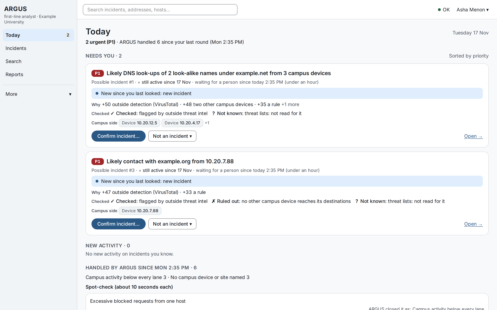<br/><sub><b>4 · Today</b>: what needs a person, with why ARGUS raised it</sub></td>
    <td width="50%">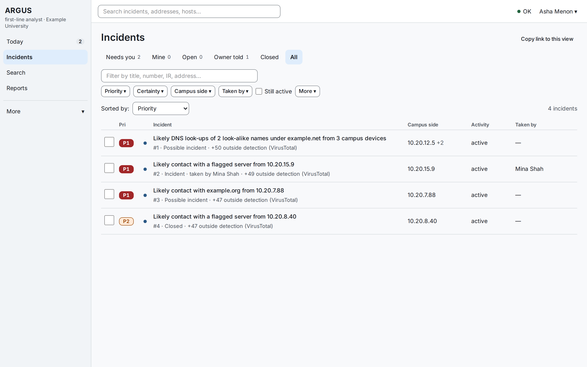<br/><sub><b>5 · Incidents</b>: one queue by priority, with who has taken what</sub></td>
  </tr>
  <tr>
    <td width="50%">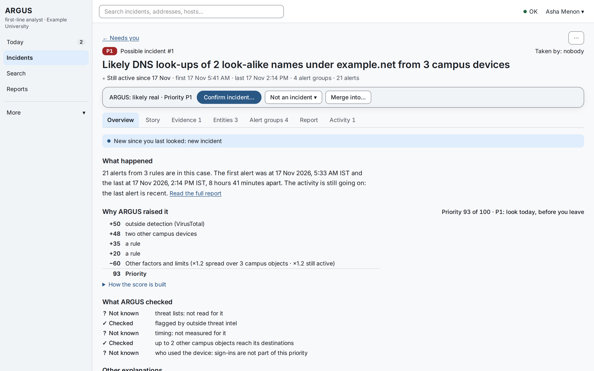<br/><sub><b>6 · An incident</b>: the score's reasons add up; what was checked and ruled out</sub></td>
    <td width="50%"><br/><sub><b>7 · An alert group</b>: the key facts, each with its alerts, and five outcomes</sub></td>
  </tr>
  <tr>
    <td width="50%"><br/><sub><b>8 · The incident report</b>: written by code, every number from a cited fact</sub></td>
    <td width="50%">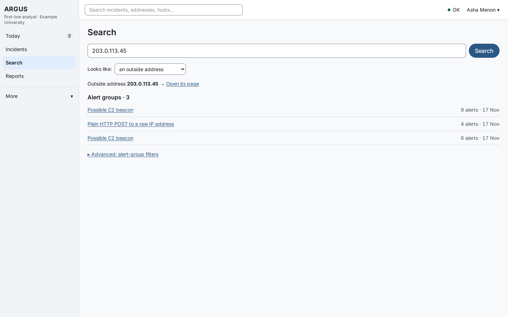<br/><sub><b>9 · Search</b>: one box for an address, a host, an account or a rule</sub></td>
  </tr>
  <tr>
    <td width="50%">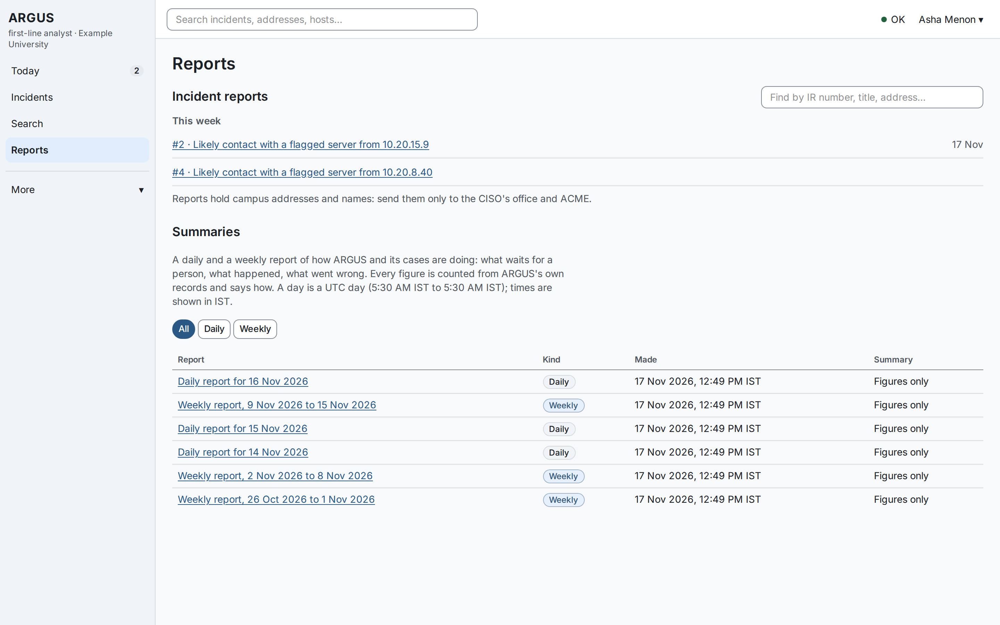<br/><sub><b>10 · Reports</b>: incident reports, then daily and weekly summaries</sub></td>
    <td width="50%"></td>
  </tr>
</table>

### Run it from the browser

<table>
  <tr>
    <td width="50%">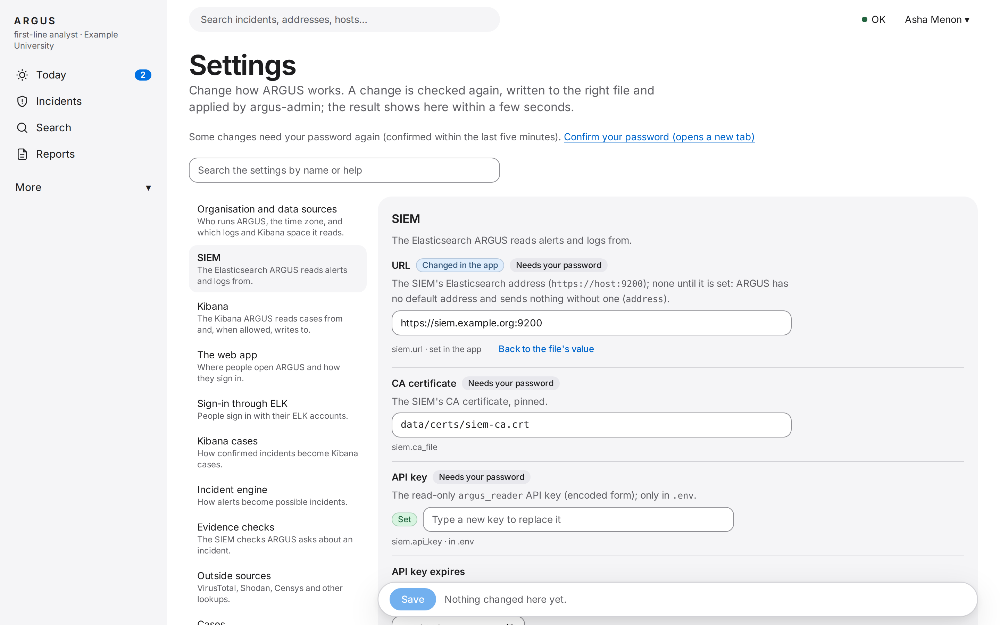<br/><sub><b>11 · Settings</b>: every setting with its help, applied for you</sub></td>
    <td width="50%"><br/><sub><b>12 · Users and roles</b>: people, roles and one-time links</sub></td>
  </tr>
  <tr>
    <td width="50%"><br/><sub><b>13 · AI and agents</b>: ARGUS's tested team; free providers first, paid ones capped</sub></td>
    <td width="50%"><br/><sub><b>14 · Threat intel</b>: free keys, their limits and a test</sub></td>
  </tr>
  <tr>
    <td width="50%"><br/><sub><b>15 · Costs and usage</b>: every dollar and lookup against its limit</sub></td>
    <td width="50%">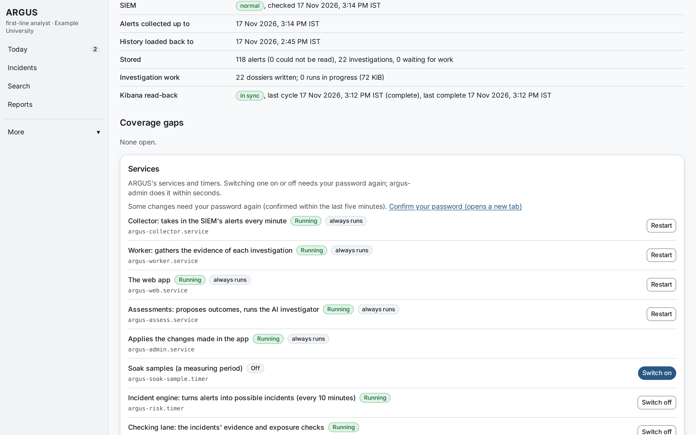<br/><sub><b>16 · System health</b>: is data arriving; the services, on or off</sub></td>
  </tr>
  <tr>
    <td width="50%">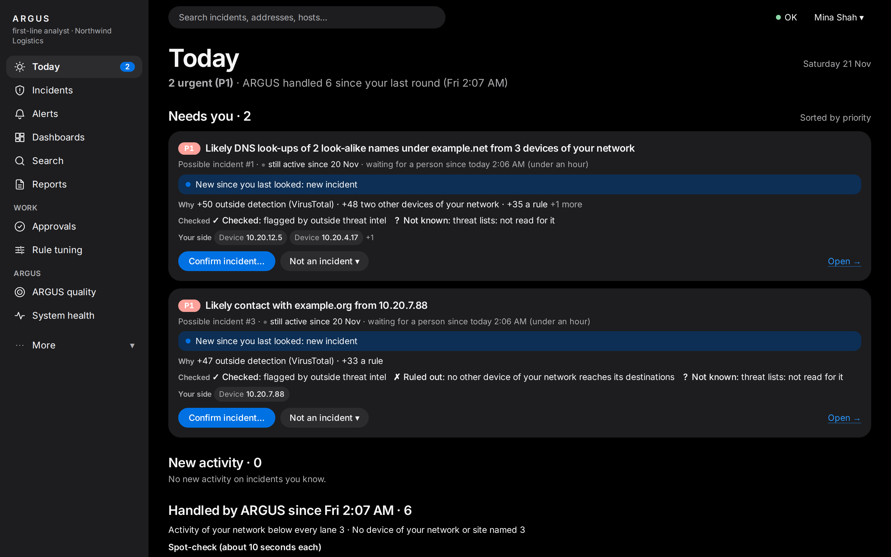<br/><sub><b>17 · Dark mode</b>: follows the system setting</sub></td>
    <td width="50%">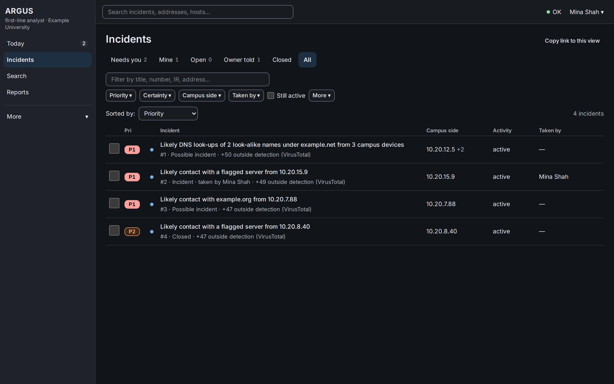<br/><sub><b>18 · Incidents, dark</b>: the same queue at night</sub></td>
  </tr>
  <tr>
    <td width="50%">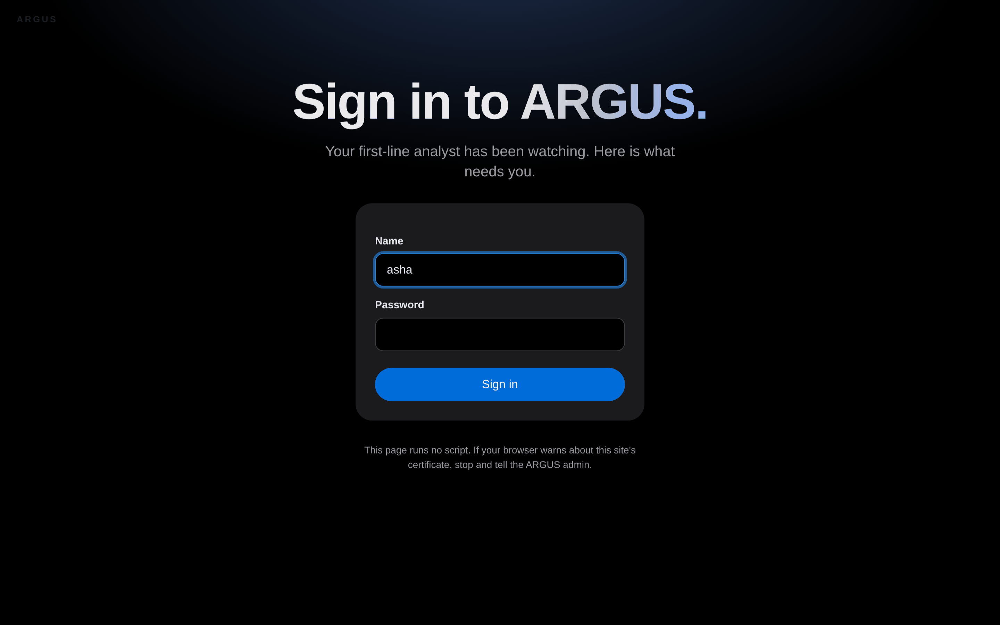<br/><sub><b>19 · Sign in</b>: a page that runs no script</sub></td>
    <td width="50%"></td>
  </tr>
</table>

## Key Features

- **Owns every alert** — takes in every Security alert of a Kibana space every minute, backfills
  a configurable history (`history.window`, 5 days by default), reconciles hourly so nothing is
  lost between reviews, and quarantines (never drops) an alert it cannot read.
- **Incidents, not alerts** — an incident engine scores every alert group and evidence fact on the
  campus side (device, account, site), links them across rules, days and log families by shared
  hosts, accounts, flagged or rare indicators and campaigns (never through hubs such as NAT,
  proxies or resolvers), and puts in front of a person only what crosses a lane (decisive, burst,
  slow, campaign, exposure). Each incident carries a priority (P1–P4), a certainty word, a "why"
  line whose points add up, what was checked, and the benign explanations it ruled out; plain
  internet scanning goes to a "handled by ARGUS" digest. A campus site that really served a file
  is verified by a capped checking lane before anyone reads "served".
- **Groups before people look** — one investigation per rule, actor and day; alike investigations
  form patterns a reviewer decides at once. Thousands of alerts become hundreds of decisions.
- **Deterministic evidence** — bounded, read-only questions to your proxy, web, DNS and sign-in
  logs, your threat-intel indices and the host's history, chosen by each log family's role. A
  missing log is *unknown*, never *clean*.
- **Proposes, with reasons** — a decision engine learned from your reviewers' verdicts proposes
  outcomes where they agree; a **safety floor** in code never lets "benign" through while a danger
  sign is present or unknown.
- **An optional AI investigator** — a lead agent with web, proxy and threat-intel specialists
  reads a **pseudonymised** dossier, may run a fixed list of read-only checks, and answers with a
  verdict, hypotheses and cited facts; code checks every citation. One run per **pattern**, not
  per alert.
- **An analyst's queue modelled on the big SOC tools** — four pages (Today · Incidents · Search ·
  Reports): incident cards and a queue with a preview pane, a sticky decision bar (confirm, not an
  incident with a reason, merge, "I'm checking"), entity pages for devices, accounts, sites and
  outside addresses, keyboard shortcuts, light and dark, phone layouts. Titles say what happened,
  to what, how sure ARGUS is and what came of it; a checker refuses any claim without a fact.
- **Cases and incident reports** — suggested cases (campaigns, a host flagged by several rules,
  actors on the same rare targets), a case lifecycle with two-person closures, known infections
  that stop re-raising what an owner was already told, and an incident report as a page, a PDF
  with a one-page dashboard, and CSVs.
- **A Kibana case team** — when you switch it on, ARGUS posts a person-confirmed incident to
  Kibana Cases as **seven Kibana users** (lead, evidence, visualiser, intel, responder, hunter,
  reporter), each owning its part, with the files in the Files tab and live charts of the alerts.
  It creates those users and keys itself, with one command.
- **Protects the SIEM** — every request goes through the Elastic Gateway: a budget in server time
  (60 minutes a day by default; one site measures 6–9), health states that slow ARGUS down and
  then stop it, quiet hours, an overload breaker, kill switches and a ledger of every request.
- **Cost-first AI** — no keys means $0; free tiers (Groq, OpenRouter, Google Gemini) first; paid
  fallbacks (OpenAI, then Anthropic) only when no free provider can answer, within daily and
  monthly caps overall and per provider. Measured: about **$0.60 to $1.20 a day**.
- **A complete application, run from the browser** — one command installs it (`./install.sh`); a
  first-time setup in the app connects your SIEM; **Settings** holds every setting with its help
  (each change checked, applied by `argus-admin` within seconds, rolled back by itself if a
  service does not come back), checks the SIEM's and Kibana's keys, takes the asset map as an
  upload and keeps the history of changes; **Users and roles** gives people a role and a one-time
  link to set their own password; **AI and agents** takes the AI providers' keys, their switches
  and spending limits, tests each provider, stops all AI calls at once and shows every agent;
  **Threat intel** takes and tests the VirusTotal, Shodan and Censys keys; **Costs and usage**
  charts what the AI cost a day and by task and each source's lookups against its free plan.
  Keys are sealed and never shown again; anything that would write to your SIEM needs an
  administrator's password and a typed confirmation.
- **Operable** — `argus doctor` checks every part with the fix for each problem, verified
  backups with a weekly restore drill, a retention purge, systemd units rendered for your machine.

The full catalogue: [docs/features.md](docs/features.md).

## Architecture

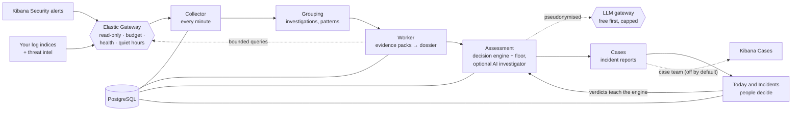

Every arrow into the SIEM goes through the Elastic Gateway; every arrow to a model goes through
the LLM gateway and its privacy layer. Full diagrams (the gateway, health states, the privacy
layer, the database, the services): [docs/architecture.md](docs/architecture.md).

## Getting Started

### Prerequisites

| | Required | Notes |
|---|---|---|
| A Linux machine with systemd | yes | 2 vCPU / 4 GB RAM / 50 GB SSD at least; 4 vCPU / 8 GB / 100 GB recommended; ARGUS uses about 1.2 GB of memory |
| Docker Engine with compose v2 and git; the account in the `docker` group | yes | `./install.sh` installs uv and Python 3.12 itself; Node.js is not needed |
| Elasticsearch and Kibana **8.x or 9.x** with Kibana Security, over HTTPS | yes | **any licence, the free Basic included**; self-managed tested ([compatibility](docs/compatibility.md)) |
| An Elastic administrator's login for the setup, once (ARGUS makes its own read-only keys), or one read-only API key made by hand | yes | the login is never stored; the exact request: [docs/install.md](docs/install.md#32-the-api-keys-argus-asks-for) |
| LLM keys (Groq, OpenRouter, Gemini free; OpenAI paid) | no | without them ARGUS investigates deterministically |

### Install: one command, then the browser

```bash
git clone https://github.com/sankettaware16/argus.git
cd argus
./install.sh
```

`./install.sh` asks nothing. It installs uv and ARGUS's packages, starts PostgreSQL in Docker with
new passwords, makes the web's certificate for this machine's address and starts two services:
the web app and `argus-admin`, which applies the changes people make in the app. It ends with a
one-time link for the first administrator:

```
    https://192.0.2.10:8765/welcome?token=…
```

Open it, choose a password and sign in: the first-time setup opens by itself. One question per
screen: your organisation (name, domains, networks, time zone), Elasticsearch's address (ARGUS
shows the certificate it presents, for you to compare and trust), then **an Elastic
administrator's login, used once and never stored, so ARGUS makes its own read-only keys** (or
read-only keys you paste), Kibana, and optionally your AI and threat-intel keys and asset map.
ARGUS then discovers your log families, Kibana space and threat-intel sources (metadata only),
writes its configuration and starts every service. The first incidents arrive in minutes. Lost
the link? Run `./install.sh` again.

The whole path, including how to make the read-only key and how to install from the terminal
alone (`uv run argus init`, interactive or with an answers file):
[docs/install.md](docs/install.md).

### Run it from the app

| To… | Go to |
|---|---|
| Change a setting: the SIEM, Kibana, notices, retention, backups, sign-in, the incident engine; check the SIEM's and Kibana's keys; upload the asset map; see who changed what | **More → Administration → Settings** |
| Add people, give them a role (Viewer, Analyst, Lead, Administrator), reset a password | **More → Administration → Users and roles** |
| Add the AI providers' keys (Groq, OpenRouter, Gemini, OpenAI, Anthropic, a model on your network), switch them on or off, set the spending limits, test them, stop all AI calls; see the agents | **More → Administration → AI and agents** |
| Add and test the threat-intel keys (VirusTotal, Shodan, Censys) | **More → Administration → Threat intel** |
| See what the AI cost a day and by task, and the threat-intel lookups against their free plans | **More → Administration → Costs and usage** |
| See whether data is arriving | **More → System health** |
| Work incidents | **Today**, **Incidents**, **Search**, **Reports** ([guide](docs/web-ui-guide.md)) |

Only upgrading ([docs/upgrading.md](docs/upgrading.md)), restoring a backup and recovery when the
web itself is down (`uv run argus doctor`) stay on the server.

### AI and threat-intel keys (optional)

ARGUS works without any model and without outside lookups: it investigates deterministically.
To add them:

1. **Settings → Asset map → Upload an asset map** (which addresses and names are yours): ARGUS
   needs it before any of your data is sent anywhere, so its privacy layer can replace your
   internal names and addresses with pseudonyms.
2. **AI and agents**: on a provider's card, **Add key**, paste, confirm your password, then
   **Test**. Free providers are tried first, paid ones last, under the monthly and daily limits
   you set on the same page.
3. **Threat intel**: add the VirusTotal, Shodan or Censys key the same way and **Test** it (one
   lookup of a public test address, counted under the free plan's limits).

Keys are sealed in the browser's request and only `argus-admin` on the server can open them; the
app never shows a key again. Where to get each key, step by step:
[docs/llm.md](docs/llm.md#3-getting-each-key-step-by-step).

## Usage

People use ARGUS from the browser; the command line is for the server-side jobs above and for
recovery.

| # | Interface | For | Needs a terminal? |
|---|---|---|---|
| 1 | **The web app** (`argus-web`, [guide](docs/web-ui-guide.md)) | everyone: incidents, cases, reports, approvals; administrators: settings, users and roles | no |
| 2 | **Kibana** ([integration](docs/kibana.md)) | the read-back of cases; the case team's posts (off by default) | no |
| 3 | **Command line** (`uv run argus ...`) | the server: install, upgrade, backups, recovery, kill switches | yes |

| Service | What it does |
|---|---|
| `argus-collector` | probes the SIEM's health and takes in new alerts every minute, reconciles hourly |
| `argus-worker` | gathers the evidence and writes a dossier for each queued investigation |
| `argus-assess` | proposes outcomes (decision engine, then the optional AI investigator), suggests cases, writes incident reports and the weekly tuning report |
| `argus-web` | the web app and its API, over HTTPS on the address set at install (or `127.0.0.1:8765`) |
| `argus-admin` | applies the settings and first-time setup people do in the app; never reachable from the network |

For the server (every command has `--help`; day-to-day operation:
[docs/operations.md](docs/operations.md)):

```bash
uv run argus doctor                  # every part, offline, with the fix for each problem
uv run argus admin status            # the latest changes made in the app, and what became of each
uv run argus siem status             # the SIEM's health state, kill switches, today's budget
uv run argus siem stop --reason "…"  # stop every request to the SIEM at once
uv run argus backup check            # a dump and a verified restore of it
uv run argus break-glass --help      # a view-and-review account for when ELK sign-in is down
```

## Cost

The machine is the only fixed cost. Language models are optional, free tiers come first, and the
paid fallback is capped. Measured on one production installation (a university SIEM, about
12,000 alerts a day) over 14 days:

| | Calls | Cost |
|---|---:|---:|
| Free providers (Gemini 2,428 · OpenRouter 462 · Groq 252) | 3,142 | **$0.00** |
| Paid fallback (OpenAI) | 1,957 | $8.47 |
| **Total** | **5,099** | **$8.47 — about $0.60 a day** |

On its busiest days the paid fallback spent $1.10–$1.20 and stopped: the investigator may use 80 %
of the $1.50 daily cap. Why it stays cheap:

- **Deterministic code decides most of the work**: grouping, evidence, the decision engine, case
  suggestions and reports use no model.
- **One model run per pattern, not per alert.**
- **Free providers first**: 62 % of all calls cost nothing.
- **Small models by default**, medium only for items with a danger sign.
- **Hard caps**: $1.50 a day and $40 a month by default (and optionally per provider), shared out by priority, reserved before
  each call.
- **No keys, no calls: $0.** ARGUS still investigates every alert.

Prices, the budget's rules and how to choose your caps: [docs/costs.md](docs/costs.md).

## AI Providers

| Order | Provider | Cost | Key | Used for |
|---|---|---|---|---|
| 1 | [Groq](https://console.groq.com/keys) | free tier | `GROQ_API_KEY` | small calls (`gpt-oss-20b`, `gpt-oss-120b`) |
| 2 | [OpenRouter](https://openrouter.ai/settings/keys) | free models (`:free`) | `OPENROUTER_API_KEY` | any call, when its free models answer |
| 3 | [Google Gemini](https://aistudio.google.com/apikey) | free tier | `GEMINI_API_KEY` | any call (`gemini-3.5-flash-lite`) |
| 4 | [OpenAI](https://platform.openai.com/api-keys) | **paid**, prepaid credit | `OPENAI_API_KEY` | only when no free provider can answer, within the caps (`gpt-5.4-nano`, `gpt-5.4-mini`) |
| 5 | [Anthropic](https://console.anthropic.com/settings/keys) | **paid**, prepaid credit | `ANTHROPIC_API_KEY` | after OpenAI, within its own caps (`claude-haiku-5-5`, `claude-sonnet-5-5`; spoken through its own Messages API) |
| – | your own OpenAI-compatible server | your hardware | `LOCAL_LLM_API_KEY` | optional; shipped disabled |

The keys live in one `NAME=value` file (mode 600) outside the checkout, which `argus init` records
in `config/llm.local.yaml`. Before any text leaves, the **privacy layer** replaces your internal
addresses, host names, user names and domains with per-item pseudonyms, withholds every field the
data policy does not allow, and a validator checks the exact bytes. Sign-in user names and
reviewers' notes are never sent. Every provider, key and rule: [docs/llm.md](docs/llm.md); the
agents and how to change them: [docs/agents.md](docs/agents.md).

## The Case Team

ARGUS can post a confirmed incident into **Kibana Cases** as a team of seven Kibana users, so the
case's timeline shows who said what:

| Kibana user | Owns |
|---|---|
| `argus-lead` | opens the case, attaches and tags its alerts, gives the verdict last |
| `argus-evidence` | the evidence with hypotheses, the affected devices |
| `argus-visualiser` | "Incident at a glance": numbers and live Kibana charts (optional) |
| `argus-intel` | threat intel, when there is an outside answer |
| `argus-responder` | recommended actions, each with its owner |
| `argus-hunter` | KQL and ES\|QL queries to check it yourself |
| `argus-reporter` | the incident PDF, the dashboard PDF and two CSVs in the Files tab |

```bash
uv run argus case team provision                               # the plan: two roles, seven users, seven keys
uv run argus case team provision --apply --admin-user elastic  # create them (the password is asked once)
uv run argus case team preview 1 --text --requests             # exactly what would be posted
```

Posting is **off** until you switch it on; the first case waits for a person's approval of its
exact plan in Approvals, and people answer in Kibana with a `Verdict:` comment that ARGUS reads
back. The guide: [docs/case-team.md](docs/case-team.md).

## Tech Stack

| Layer | Technology |
|---|---|
| Language and runs | Python 3.12 (typed, `mypy --strict`), [uv](https://docs.astral.sh/uv/) with a locked environment |
| API and web server | FastAPI, uvicorn, Jinja2 |
| Database | PostgreSQL 17 (Docker, pinned by digest), SQLAlchemy 2 async, psycopg 3, Alembic migrations |
| Settings and contracts | pydantic v2, pydantic-settings |
| Investigation graphs | LangGraph with Postgres checkpoints (deterministic: no model inside) |
| HTTP and logging | httpx with pinned TLS, structlog with secret redaction |
| Command line | typer |
| Reports | reportlab (PDFs), CSV |
| Security | argon2-cffi, cryptography |
| Web app | React 19, TypeScript, Vite, TanStack Router and Query, Base UI, Tailwind CSS 4 |
| Running | systemd user units, Docker compose v2 |
| Testing | pytest, Hypothesis, schemathesis, Vitest, MSW, Playwright, Stryker; a local Elasticsearch and Kibana 8.19 tier |

Details: [docs/architecture.md](docs/architecture.md#tech-stack).

## Repository Structure

```
├── src/argus/            # The package
│   ├── gateway/          #   the Elastic Gateway (budget, health, breaker, lanes, validator, Kibana lane)
│   ├── collector/        #   alerts in, backfill, reconciliation
│   ├── grouping/         #   alerts into investigations
│   ├── context/          #   evidence packs and the LangGraph evidence graph
│   ├── assess/           #   the decision engine, proposals, patterns
│   ├── agent/            #   the AI investigator: loader, registry, tool catalogue
│   ├── llm/              #   the LLM gateway, budgets and the privacy layer
│   ├── cases/            #   suggested cases, the lifecycle, known infections, the watch
│   ├── incident/         #   incident reports, the PDF, the dashboard, the CSVs
│   ├── caseteam/         #   the Kibana case team
│   ├── web/              #   the app and its API (the built app in web/spa/)
│   ├── install/          #   argus init
│   ├── ops/              #   backups, purge, units, doctor checks
│   └── db/migrations/    #   Alembic migrations
├── config/               # argus.yaml (defaults), llm.yaml, the data policy, agents/*.md, actions.yaml
├── deploy/systemd/       # Unit templates, rendered per installation by `argus units install`
├── frontend/             # The React app's sources (its build is committed)
├── docs/                 # Documentation (see below); api/openapi-v1.json
├── scripts/              # Developer tools: the gate, the local Kibana tier, builds
├── tests/                # unit/, integration/, kibana/: on a made-up site, never a real SIEM
├── docker-compose.yml    # PostgreSQL (and the optional local Kibana tier for tests)
└── .env.example          # The names of the secrets (argus init writes the real .env)
```

## Documentation

| Document | Contents |
|---|---|
| [Installation](docs/install.md) | `./install.sh` and the first-time setup in the browser; then the full reference: requirements, Docker and uv per distribution, the SIEM's API keys, installing from the terminal (`argus init`, scripted), TLS, verification |
| [Features](docs/features.md) | Everything ARGUS can do, area by area, with what is on and off by default |
| [Configuration](docs/configuration.md) | Where every value lives, the files and their precedence, the site, every section of `config/argus.yaml`, the load budget |
| [Architecture](docs/architecture.md) | The pipeline, the Elastic Gateway, the privacy layer, the database, the services, the tech stack |
| [AI providers and keys](docs/llm.md) | Each provider, how to get its key, where it goes, the routing rules, the caps, the privacy layer, the asset map |
| [Costs](docs/costs.md) | Measured spending, model prices, the budget's rules, choosing caps |
| [The investigation agents](docs/agents.md) | The investigator and its specialists, their tools, how to change or add one |
| [The case team](docs/case-team.md) | The seven Kibana users, provisioning, switching posting on, the canary, the read-back |
| [Operations](docs/operations.md) | Services and timers, `argus doctor`, logs, backups, retention, kill switches, key rotation, certificates |
| [Web UI Guide](docs/web-ui-guide.md) | Sign-in, every page, approvals, Settings, Users and roles, ELK sign-in |
| [Reviewers' guide](docs/guide-ta-ra.md) | One page for the people who review alerts every day |
| [Kibana integration](docs/kibana.md) | The reader key, the read-back, the self-test, write classes (off by default) |
| [Upgrading](docs/upgrading.md) | A verified backup, migrate, reinstall the units, restart; rolling back |
| [Troubleshooting](docs/troubleshooting.md) | Real messages and their fixes |
| [Development & Testing](docs/development.md) | The test profiles, the network guard, the Kibana tier, migrations, the web app |
| [Roadmap](docs/roadmap.md) | What exists, what is off by default, what is planned |

## TLSOC Ecosystem

ARGUS stands on its own: any organisation that runs Elastic as its SIEM can use it, with no other
component of the TLSOC Ecosystem ([docs/compatibility.md](docs/compatibility.md)). It is also one part of the
TLSOC Ecosystem, an open-source security operations platform:

| Repository | Purpose |
|---|---|
| [TLSOC Ecosystem](https://github.com/sankettaware16/tlsoc) | Ecosystem home: documentation, architecture, roadmap |
| [foss-soc-engine](https://github.com/sankettaware16/foss-soc-engine) | Log parsing and ECS normalisation engine |
| [TLSOCDockerDeploy](https://github.com/sankettaware16/TLSOCDockerDeploy) | TLS-secured core stack: Kafka, Logstash, Elasticsearch, Kibana |
| [TLSOC-Dashboards](https://github.com/sankettaware16/TLSOC-Dashboards) | SOC platform: a fork of OpenSearch Dashboards |
| [tlsoc-reporting-framework](https://github.com/sankettaware16/tlsoc-reporting-framework) | Declarative executive reporting (HTML/PDF) |
| **argus** (this repository) | The always-on first-line analyst for Elastic SIEM |

ARGUS needs none of the others: it works with any Elastic SIEM.

## Roadmap

Highlights; the full list is in [docs/roadmap.md](docs/roadmap.md):

- The deterministic investigation wave and the daily case watch switched on after their load is
  measured.
- Alert status write-back to Kibana in real use, after its canary.
- A local model for helper tasks, each task only after its evaluation against the gold set.

## Contributing

Bug reports, fixes, documentation and features are welcome: see [CONTRIBUTING.md](CONTRIBUTING.md)
and [docs/development.md](docs/development.md). Every change runs the test suite on a made-up
site; the suite never leaves the machine. Please follow our [Code of Conduct](CODE_OF_CONDUCT.md).

## Security

Report vulnerabilities privately as described in [SECURITY.md](SECURITY.md), never in a public
issue.

## License

Free and open-source software under the [Apache License 2.0](LICENSE).

---

<p align="center">
  Part of the <a href="https://github.com/sankettaware16/tlsoc">TLSOC Ecosystem</a>
</p>

<p align="center">
  <a href="https://github.com/sankettaware16/tlsoc">Ecosystem</a> •
  <a href="https://github.com/sankettaware16/foss-soc-engine">Engine</a> •
  <a href="https://github.com/sankettaware16/TLSOCDockerDeploy">Deploy</a> •
  <a href="https://github.com/sankettaware16/TLSOC-Dashboards">Dashboards</a> •
  <a href="https://github.com/sankettaware16/tlsoc-reporting-framework">Reporting</a> •
  <a href="https://github.com/sankettaware16/argus">ARGUS</a>
</p>
