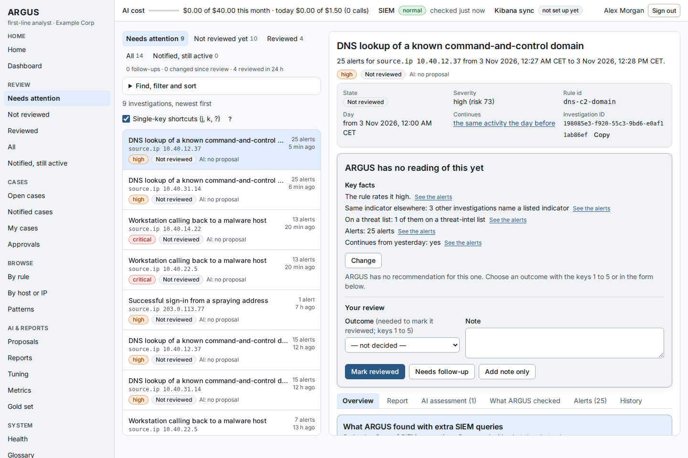
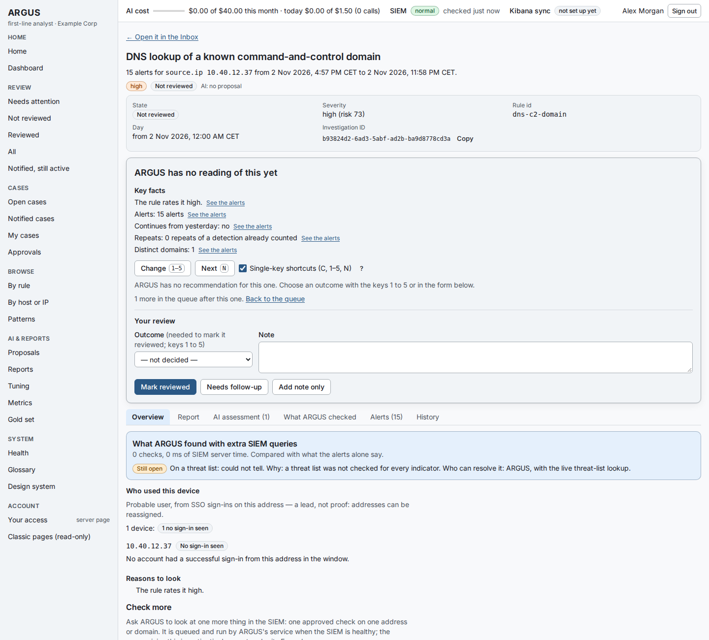
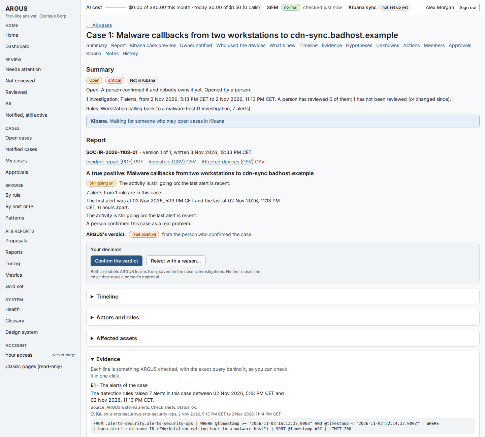
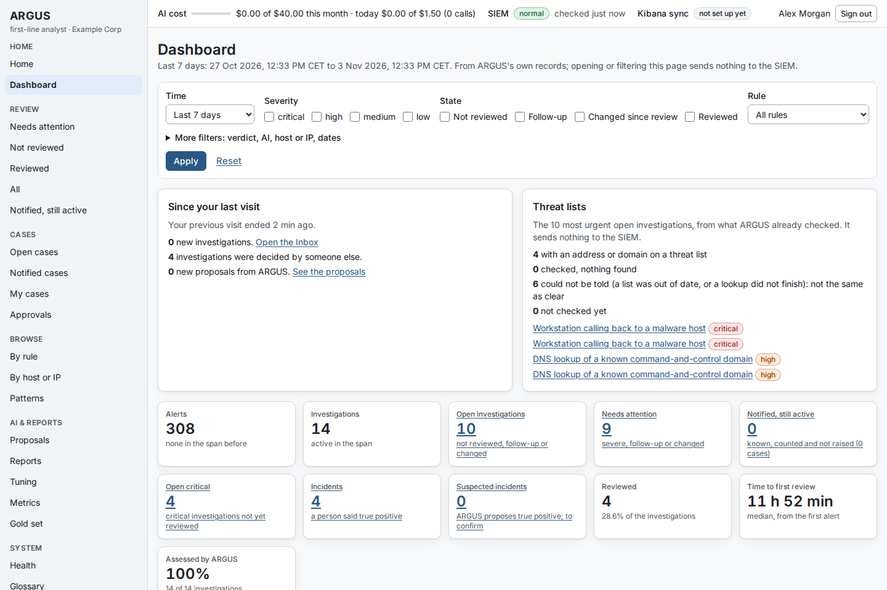
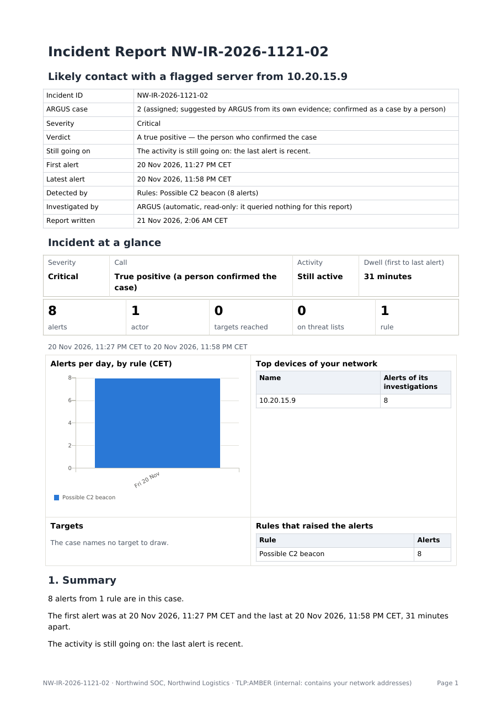
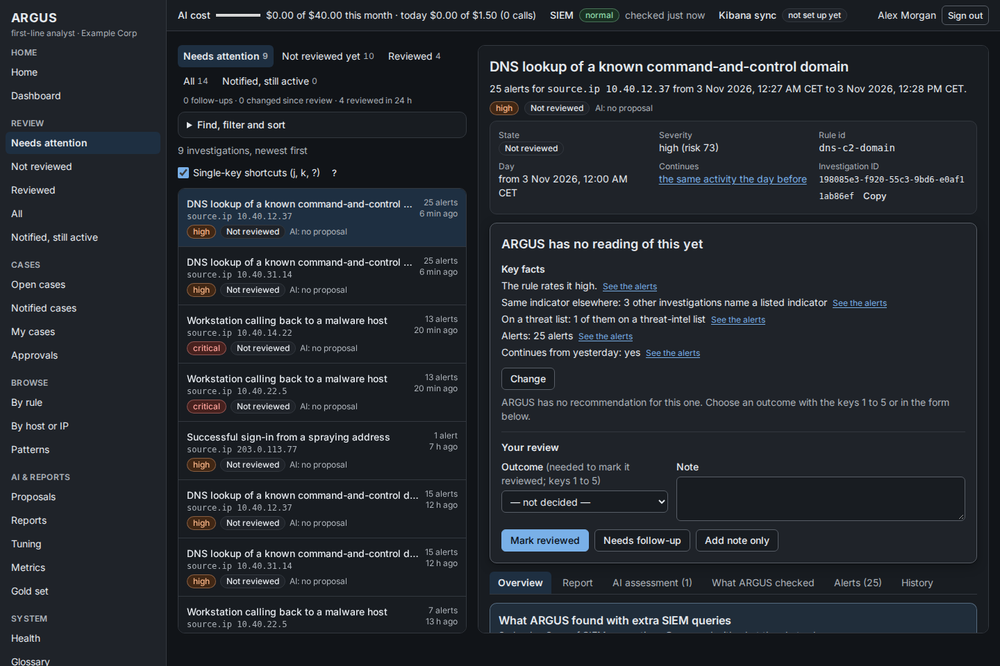
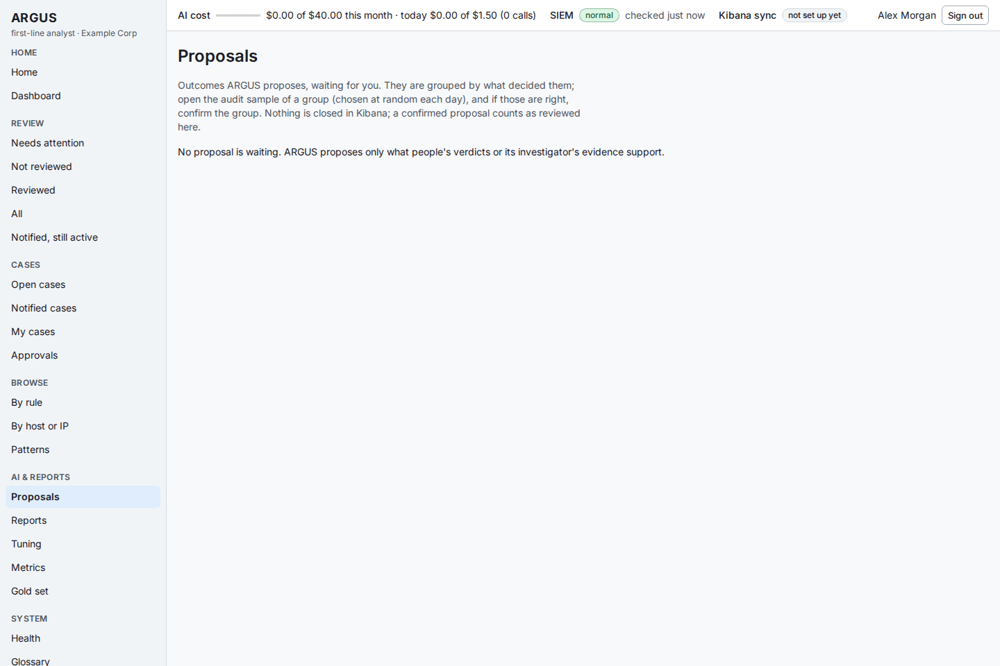
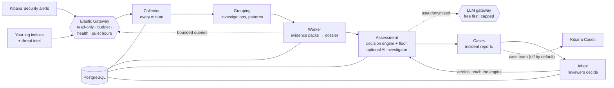

<h1 align="center">ARGUS</h1>

<p align="center">
  <b>AI-Guided Investigation &amp; Evidence Orchestration System</b><br/>
  An always-on first-line SOC analyst for Elastic SIEM: it takes in every alert, groups and
  investigates them, and leaves people a short, explained, reviewed queue.
</p>

<p align="center">
  <a href="https://github.com/sankettaware16/tlsoc"></a>
  <a href="LICENSE"></a>
  
  
  
  
  
</p>

<p align="center">
  <a href="#getting-started">Getting Started</a> •
  <a href="docs/features.md">Features</a> •
  <a href="docs/architecture.md">Architecture</a> •
  <a href="docs/install.md">Installation</a> •
  <a href="docs/llm.md">AI Providers</a> •
  <a href="docs/costs.md">Costs</a> •
  <a href="docs/case-team.md">Case Team</a> •
  <a href="#tlsoc-ecosystem">Ecosystem</a>
</p>

---

## Overview

Many security teams cannot watch their SIEM around the clock. Alerts pile up between reviews, and
one incident shows up as dozens of separate alerts. **ARGUS** sits on top of an existing Elastic
SIEM (Elasticsearch and Kibana Security, any licence, Basic included) and **owns every alert**:

1. it takes in each Security alert within a minute, and never loses one;
2. it groups duplicates into **investigations** and alike investigations into **patterns**;
3. it gathers the evidence an analyst would look for, from your own logs, into a **dossier** in
   which every fact names its source and the query behind it;
4. it **proposes an outcome**: a deterministic decision engine learned from your reviewers' own
   verdicts, and optionally an **AI investigator** behind a privacy layer, for what the engine
   cannot decide;
5. it **suggests cases** across investigations and writes each case's **incident report** (a page,
   a PDF and CSVs);
6. it leaves people a calm **Inbox** to confirm or correct, and, when you switch it on, posts the
   confirmed incident to **Kibana Cases** as a team of seven named Kibana users.

ARGUS reads your SIEM with a **read-only key**, through a gateway that holds it to a daily load
budget and backs off when the cluster is busy. It writes nothing to the SIEM unless you switch a
write on yourself, and nothing is closed without a person. It runs with **no AI at all**; with
AI keys it uses **free providers first** and caps paid use per day and per month.



## Screenshots

<table>
  <tr>
    <td width="50%"><br/><sub><b>Investigation</b>: the verdict in a few lines, every fact with its query</sub></td>
    <td width="50%"><br/><sub><b>Case</b>: one real problem across hosts, rules and days</sub></td>
  </tr>
  <tr>
    <td width="50%"><br/><sub><b>Dashboard</b>: alerts, investigations and incidents at a glance</sub></td>
    <td width="50%"><br/><sub><b>Incident report</b>: written by code, every number from a cited fact</sub></td>
  </tr>
  <tr>
    <td width="50%"><br/><sub><b>Dark mode</b>: follows the system setting</sub></td>
    <td width="50%"><br/><sub><b>Proposals</b>: confirm a whole group after checking its sample</sub></td>
  </tr>
</table>

The screenshots show a demo installation on made-up data. More in the
[Web UI guide](docs/web-ui-guide.md).

## Key Features

- **Owns every alert** — takes in every Security alert of a Kibana space every minute, backfills
  a configurable history (`history.window`, 5 days by default), reconciles hourly so nothing is
  lost between reviews, and quarantines (never drops) an alert it cannot read.
- **Groups before people look** — one investigation per rule, actor and day; alike investigations
  form patterns a reviewer decides at once. Thousands of alerts become hundreds of decisions.
- **Deterministic evidence** — bounded, read-only questions to your proxy, web, DNS and sign-in
  logs, your threat-intel indices and the host's history, chosen by each log family's role. A
  missing log is *unknown*, never *clean*.
- **Proposes, with reasons** — a decision engine learned from your reviewers' verdicts proposes
  outcomes where they agree; a **safety floor** in code never lets "benign" through while a danger
  sign is present or unknown.
- **An optional AI investigator** — a lead agent with web, proxy and threat-intel specialists
  reads a **pseudonymised** dossier, may run a fixed list of read-only checks, and answers with a
  verdict, hypotheses and cited facts; code checks every citation. One run per **pattern**, not
  per alert.
- **Cases and incident reports** — suggested cases (campaigns, a host flagged by several rules,
  actors on the same rare targets), a case lifecycle with two-person closures, known infections
  that stop re-raising what an owner was already told, and an incident report as a page, a PDF
  with a one-page dashboard, and CSVs.
- **A Kibana case team** — when you switch it on, ARGUS posts a person-confirmed incident to
  Kibana Cases as **seven Kibana users** (lead, evidence, visualiser, intel, responder, hunter,
  reporter), each owning its part, with the files in the Files tab and live charts of the alerts.
  It creates those users and keys itself, with one command.
- **Protects the SIEM** — every request goes through the Elastic Gateway: a budget in server time
  (60 minutes a day by default; one site measures 6–9), health states that slow ARGUS down and
  then stop it, quiet hours, an overload breaker, kill switches and a ledger of every request.
- **Cost-first AI** — no keys means $0; free tiers (Groq, OpenRouter, Google Gemini) first; a paid
  fallback (OpenAI) only when no free provider can answer, within a daily and a monthly cap.
  Measured: about **$0.60 a day**.
- **Operable** — one command installs it (`argus init`, interactive or scripted), `argus doctor`
  checks every part with the fix for each problem, verified backups with a weekly restore drill,
  a retention purge, systemd units rendered for your machine.

The full catalogue: [docs/features.md](docs/features.md).

## Architecture



Every arrow into the SIEM goes through the Elastic Gateway; every arrow to a model goes through
the LLM gateway and its privacy layer. Full diagrams (the gateway, health states, the privacy
layer, the database, the services): [docs/architecture.md](docs/architecture.md).

## Getting Started

### Prerequisites

| | Required | Notes |
|---|---|---|
| A Linux machine with systemd | yes | 2 vCPU / 4 GB RAM / 50 GB SSD at least; 4 vCPU / 8 GB / 100 GB recommended; ARGUS uses about 1.2 GB of memory |
| Docker Engine with compose v2, git, [uv](https://docs.astral.sh/uv/) | yes | uv fetches Python 3.12 itself; Node.js is not needed |
| Elasticsearch and Kibana **8.x or 9.x** with Kibana Security, over HTTPS | yes | any licence, Basic included |
| Someone who can create an API key in it, for five minutes | yes | ARGUS prints the exact read-only request |
| LLM keys (Groq, OpenRouter, Gemini free; OpenAI paid) | no | without them ARGUS investigates deterministically |

### Install

```bash
git clone https://github.com/sankettaware16/argus.git
cd argus
uv run argus init
```

`argus init` checks the prerequisites, writes `.env` with generated database passwords, starts
PostgreSQL in Docker and creates the schema, pins your SIEM's CA, prints the Dev Tools request for
the read-only key and checks the key you paste, asks about your organisation, **discovers** your
log families, Kibana space and threat-intel sources (metadata only), asks for your LLM keys file
(optional), sets up the web (the address people open, a certificate signed by your CA or
self-signed, your own sign-in), installs the systemd user units, starts them if you say so, and
ends with `argus doctor`. A key or date pasted in the wrong form is explained and asked again.
Rerun it any time: it keeps what is done. For a scripted install:
`uv run argus init --answers answers.yaml`.

The whole path from a fresh machine, with every value and the file it lands in:
[docs/install.md](docs/install.md#0-clean-setup-from-zero).

### AI keys (optional)

```bash
install -m 600 /dev/null ~/llm-keys.env          # then paste NAME=value lines into it:
# GROQ_API_KEY=...  OPENROUTER_API_KEY=...  GEMINI_API_KEY=...  OPENAI_API_KEY=...
uv run argus assets import asset_map.yaml        # your networks: needed before any key
uv run argus init                                # step 7: give ~/llm-keys.env
uv run argus llm probe && uv run argus llm ping
```

Where to get each key, step by step: [docs/llm.md](docs/llm.md#3-getting-each-key-step-by-step).

### Run

```bash
uv run argus init --start        # starts every service, the Kibana read-back and the nightly backup
```

Init ends with the address to open (`https://<this machine>:8765/`) and you sign in with the name
and password you gave it. If it says the services stop when you log out, an administrator runs
`sudo loginctl enable-linger <account>` once. Installing on the SIEM's own machine, or moving
ARGUS to another one: [docs/install.md](docs/install.md#13-argus-on-the-siems-own-machine).

## Usage

ARGUS runs as four services; people use it from the browser, operators from the command line:

| # | Interface | For | Needs a terminal? |
|---|---|---|---|
| 1 | **Web Inbox** (`argus-web`, [guide](docs/web-ui-guide.md)) | reviewers: decide, confirm, approve, read cases and reports | no |
| 2 | **Command line** (`uv run argus ...`, about 180 commands) | operators: install, health, backups, users, kill switches | yes |
| 3 | **Kibana** ([integration](docs/kibana.md)) | the read-back of cases; the case team's posts (off by default) | no |

| Service | What it does |
|---|---|
| `argus-collector` | probes the SIEM's health and takes in new alerts every minute, reconciles hourly |
| `argus-worker` | gathers the evidence and writes a dossier for each queued investigation |
| `argus-assess` | proposes outcomes (decision engine, then the optional AI investigator), suggests cases, writes incident reports and the weekly tuning report |
| `argus-web` | the Inbox and its API, over HTTPS on the address init set up (or `127.0.0.1:8765`) |

Common tasks:

```bash
uv run argus doctor                  # every part, offline, with the fix for each problem
uv run argus siem status             # the SIEM's health state, kill switches, today's budget
uv run argus siem selftest           # TLS pin, version and the key's privileges (5 small requests)
uv run argus collect status          # what ARGUS holds
uv run argus siem stop --reason "…"  # stop every request to the SIEM at once
uv run argus llm status              # model use and cost against the caps
uv run argus case list               # the newest cases
uv run argus case report 3 --pdf report.pdf   # a case's incident report as a PDF
uv run argus backup check            # a dump and a verified restore of it
uv run argus discover                # propose the site's log families from metadata
```

Every command has `--help`. Day-to-day operation: [docs/operations.md](docs/operations.md).

## Cost

The machine is the only fixed cost. Language models are optional, free tiers come first, and the
paid fallback is capped. Measured on one production installation (a university SIEM, about
12,000 alerts a day) over 14 days:

| | Calls | Cost |
|---|---:|---:|
| Free providers (Gemini 2,428 · OpenRouter 462 · Groq 252) | 3,142 | **$0.00** |
| Paid fallback (OpenAI) | 1,957 | $8.47 |
| **Total** | **5,099** | **$8.47 — about $0.60 a day** |

On its busiest days the paid fallback spent $1.10–$1.20 and stopped: the investigator may use 80 %
of the $1.50 daily cap. Why it stays cheap:

- **Deterministic code decides most of the work**: grouping, evidence, the decision engine, case
  suggestions and reports use no model.
- **One model run per pattern, not per alert.**
- **Free providers first**: 62 % of all calls cost nothing.
- **Small models by default**, medium only for items with a danger sign.
- **Hard caps**: $1.50 a day and $40 a month by default, shared out by priority, reserved before
  each call.
- **No keys, no calls: $0.** ARGUS still investigates every alert.

Prices, the budget's rules and how to choose your caps: [docs/costs.md](docs/costs.md).

## AI Providers

| Order | Provider | Cost | Key | Used for |
|---|---|---|---|---|
| 1 | [Groq](https://console.groq.com/keys) | free tier | `GROQ_API_KEY` | small calls (`gpt-oss-20b`, `gpt-oss-120b`) |
| 2 | [OpenRouter](https://openrouter.ai/settings/keys) | free models (`:free`) | `OPENROUTER_API_KEY` | any call, when its free models answer |
| 3 | [Google Gemini](https://aistudio.google.com/apikey) | free tier | `GEMINI_API_KEY` | any call (`gemini-3.5-flash-lite`) |
| 4 | [OpenAI](https://platform.openai.com/api-keys) | **paid**, prepaid credit | `OPENAI_API_KEY` | only when no free provider can answer, within the caps (`gpt-5.4-nano`, `gpt-5.4-mini`) |
| – | your own OpenAI-compatible server | your hardware | `LOCAL_LLM_API_KEY` | optional; shipped disabled |

The keys live in one `NAME=value` file (mode 600) outside the checkout, which `argus init` records
in `config/llm.local.yaml`. Before any text leaves, the **privacy layer** replaces your internal
addresses, host names, user names and domains with per-item pseudonyms, withholds every field the
data policy does not allow, and a validator checks the exact bytes. Sign-in user names and
reviewers' notes are never sent. Every provider, key and rule: [docs/llm.md](docs/llm.md); the
agents and how to change them: [docs/agents.md](docs/agents.md).

## The Case Team

ARGUS can post a confirmed incident into **Kibana Cases** as a team of seven Kibana users, so the
case's timeline shows who said what:

| Kibana user | Owns |
|---|---|
| `argus-lead` | opens the case, attaches and tags its alerts, gives the verdict last |
| `argus-evidence` | the evidence with hypotheses, the affected devices |
| `argus-visualiser` | "Incident at a glance": numbers and live Kibana charts (optional) |
| `argus-intel` | threat intel, when there is an outside answer |
| `argus-responder` | recommended actions, each with its owner |
| `argus-hunter` | KQL and ES\|QL queries to check it yourself |
| `argus-reporter` | the incident PDF, the dashboard PDF and two CSVs in the Files tab |

```bash
uv run argus case team provision                               # the plan: two roles, seven users, seven keys
uv run argus case team provision --apply --admin-user elastic  # create them (the password is asked once)
uv run argus case team preview 1 --text --requests             # exactly what would be posted
```

Posting is **off** until you switch it on; the first case waits for a person's approval of its
exact plan in the Inbox, and people answer in Kibana with a `Verdict:` comment that ARGUS reads
back. The guide: [docs/case-team.md](docs/case-team.md).

## Tech Stack

| Layer | Technology |
|---|---|
| Language and runs | Python 3.12 (typed, `mypy --strict`), [uv](https://docs.astral.sh/uv/) with a locked environment |
| API and web server | FastAPI, uvicorn, Jinja2 |
| Database | PostgreSQL 17 (Docker, pinned by digest), SQLAlchemy 2 async, psycopg 3, Alembic migrations |
| Settings and contracts | pydantic v2, pydantic-settings |
| Investigation graphs | LangGraph with Postgres checkpoints (deterministic: no model inside) |
| HTTP and logging | httpx with pinned TLS, structlog with secret redaction |
| Command line | typer |
| Reports | reportlab (PDFs), CSV |
| Security | argon2-cffi, cryptography |
| Web app | React 19, TypeScript, Vite, TanStack Router and Query, Base UI, Tailwind CSS 4 |
| Running | systemd user units, Docker compose v2 |
| Testing | pytest, Hypothesis, schemathesis, Vitest, MSW, Playwright, Stryker; a local Elasticsearch and Kibana 8.19 tier |

Details: [docs/architecture.md](docs/architecture.md#tech-stack).

## Repository Structure

```
├── src/argus/            # The package
│   ├── gateway/          #   the Elastic Gateway (budget, health, breaker, lanes, validator, Kibana lane)
│   ├── collector/        #   alerts in, backfill, reconciliation
│   ├── grouping/         #   alerts into investigations
│   ├── context/          #   evidence packs and the LangGraph evidence graph
│   ├── assess/           #   the decision engine, proposals, patterns
│   ├── agent/            #   the AI investigator: loader, registry, tool catalogue
│   ├── llm/              #   the LLM gateway, budgets and the privacy layer
│   ├── cases/            #   suggested cases, the lifecycle, known infections, the watch
│   ├── incident/         #   incident reports, the PDF, the dashboard, the CSVs
│   ├── caseteam/         #   the Kibana case team
│   ├── web/              #   the Inbox and its API (the built app in web/spa/)
│   ├── install/          #   argus init
│   ├── ops/              #   backups, purge, units, doctor checks
│   └── db/migrations/    #   Alembic migrations
├── config/               # argus.yaml (defaults), llm.yaml, the data policy, agents/*.md, actions.yaml
├── deploy/systemd/       # Unit templates, rendered per installation by `argus units install`
├── frontend/             # The React app's sources (its build is committed)
├── docs/                 # Documentation (see below); api/openapi-v1.json
├── scripts/              # Developer tools: the gate, the local Kibana tier, builds
├── tests/                # unit/, integration/, kibana/: on a made-up site, never a real SIEM
├── docker-compose.yml    # PostgreSQL (and the optional local Kibana tier for tests)
└── .env.example          # The names of the secrets (argus init writes the real .env)
```

## Documentation

| Document | Contents |
|---|---|
| [Installation](docs/install.md) | Clean setup from zero, requirements, Docker and uv per distribution, the SIEM's API keys, `argus init` step by step, scripted installs, services, the first user, TLS, verification |
| [Features](docs/features.md) | Everything ARGUS can do, area by area, with what is on and off by default |
| [Configuration](docs/configuration.md) | Where every value lives, the files and their precedence, the site, every section of `config/argus.yaml`, the load budget |
| [Architecture](docs/architecture.md) | The pipeline, the Elastic Gateway, the privacy layer, the database, the services, the tech stack |
| [AI providers and keys](docs/llm.md) | Each provider, how to get its key, where it goes, the routing rules, the caps, the privacy layer, the asset map |
| [Costs](docs/costs.md) | Measured spending, model prices, the budget's rules, choosing caps |
| [The investigation agents](docs/agents.md) | The investigator and its specialists, their tools, how to change or add one |
| [The case team](docs/case-team.md) | The seven Kibana users, provisioning, switching posting on, the canary, the read-back |
| [Operations](docs/operations.md) | Services and timers, `argus doctor`, logs, backups, retention, kill switches, key rotation, certificates |
| [Web UI Guide](docs/web-ui-guide.md) | Sign-in, users and capabilities, every page, approvals, ELK sign-in |
| [Reviewers' guide](docs/guide-ta-ra.md) | One page for the people who review alerts every day |
| [Kibana integration](docs/kibana.md) | The reader key, the read-back, the self-test, write classes (off by default) |
| [Upgrading](docs/upgrading.md) | A verified backup, migrate, reinstall the units, restart; rolling back |
| [Troubleshooting](docs/troubleshooting.md) | Real messages and their fixes |
| [Development & Testing](docs/development.md) | The test profiles, the network guard, the Kibana tier, migrations, the web app |
| [Roadmap](docs/roadmap.md) | What exists, what is off by default, what is planned |

## TLSOC Ecosystem

ARGUS is one component of the TLSOC Ecosystem, an open-source security operations platform:

| Repository | Purpose |
|---|---|
| [TLSOC Ecosystem](https://github.com/sankettaware16/tlsoc) | Ecosystem home: documentation, architecture, roadmap |
| [foss-soc-engine](https://github.com/sankettaware16/foss-soc-engine) | Log parsing and ECS normalisation engine |
| [TLSOCDockerDeploy](https://github.com/sankettaware16/TLSOCDockerDeploy) | TLS-secured core stack: Kafka, Logstash, Elasticsearch, Kibana |
| [TLSOC-Dashboards](https://github.com/sankettaware16/TLSOC-Dashboards) | SOC platform: a fork of OpenSearch Dashboards |
| [tlsoc-reporting-framework](https://github.com/sankettaware16/tlsoc-reporting-framework) | Declarative executive reporting (HTML/PDF) |
| **argus** (this repository) | The always-on first-line analyst for Elastic SIEM |

ARGUS needs none of the others: it works with any Elastic SIEM.

## Roadmap

Highlights; the full list is in [docs/roadmap.md](docs/roadmap.md):

- The deterministic investigation wave and the daily case watch switched on after their load is
  measured.
- Alert status write-back to Kibana in real use, after its canary.
- A local model for helper tasks, each task only after its evaluation against the gold set.

## Contributing

Bug reports, fixes, documentation and features are welcome: see [CONTRIBUTING.md](CONTRIBUTING.md)
and [docs/development.md](docs/development.md). Every change runs the test suite on a made-up
site; the suite never leaves the machine. Please follow our [Code of Conduct](CODE_OF_CONDUCT.md).

## Security

Report vulnerabilities privately as described in [SECURITY.md](SECURITY.md), never in a public
issue.

## License

Free and open-source software under the [Apache License 2.0](LICENSE).

---

<p align="center">
  Part of the <a href="https://github.com/sankettaware16/tlsoc">TLSOC Ecosystem</a>
</p>

<p align="center">
  <a href="https://github.com/sankettaware16/tlsoc">Ecosystem</a> •
  <a href="https://github.com/sankettaware16/foss-soc-engine">Engine</a> •
  <a href="https://github.com/sankettaware16/TLSOCDockerDeploy">Deploy</a> •
  <a href="https://github.com/sankettaware16/TLSOC-Dashboards">Dashboards</a> •
  <a href="https://github.com/sankettaware16/tlsoc-reporting-framework">Reporting</a> •
  <a href="https://github.com/sankettaware16/argus">ARGUS</a>
</p>
