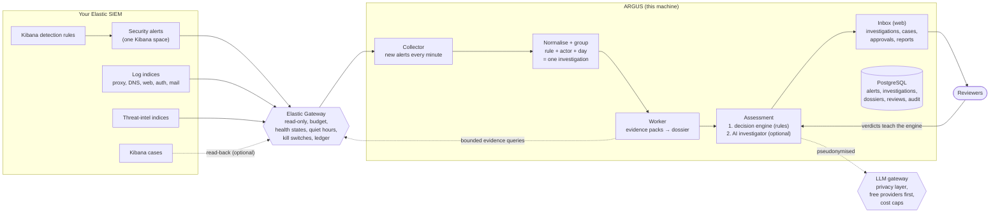
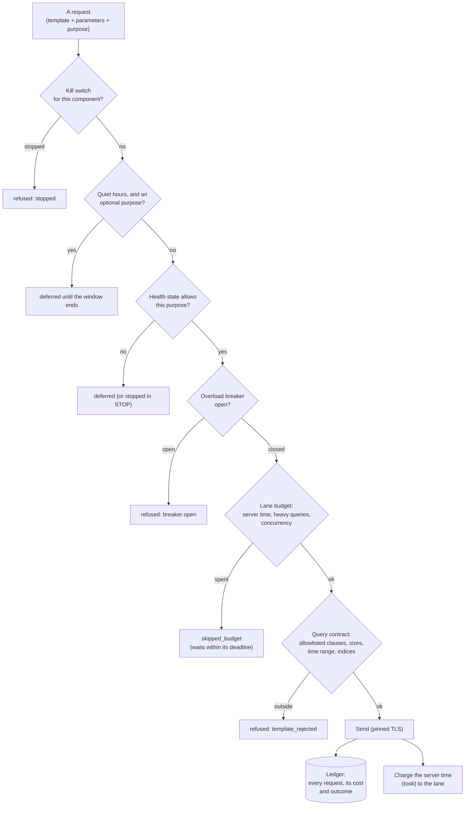
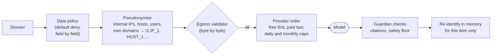
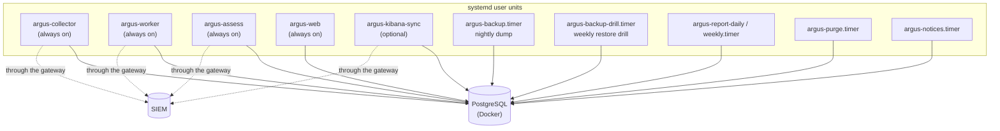

# Architecture

How ARGUS works, end to end: where an alert goes, how ARGUS protects the SIEM it reads, what it
keeps, and which process does what.

ARGUS is an always-on **first-line analyst** for an Elastic SIEM. It reads every Security alert,
groups the ones that belong together, gathers the evidence a careful analyst would look for,
proposes what happened, and leaves people a short, explained queue to confirm or correct. It
reads the SIEM through one gateway with a load budget, and nothing closes without a person.

**Contents**

- [The pipeline](#the-pipeline)
- [The life of one alert](#the-life-of-one-alert)
- [Each stage](#each-stage)
- [The Elastic Gateway](#the-elastic-gateway)
- [The LLM gateway and the privacy layer](#the-llm-gateway-and-the-privacy-layer)
- [The database](#the-database)
- [Processes, services and timers](#processes-services-and-timers)
- [What keeps it safe](#what-keeps-it-safe)
- [Tech stack](#tech-stack)
- [Where things live in the code](#where-things-live-in-the-code)

---

## The pipeline

Every arrow into the SIEM goes through the Elastic Gateway; every arrow to a model goes through
the LLM gateway and its privacy layer. Writes to Kibana exist but are off by default
([kibana.md](kibana.md)).

## The life of one alert

| When | What happens |
|---|---|
| t | A Kibana detection rule fires on DNS logs: a host looks up hundreds of random-looking subdomains of one rare domain in the middle of the night. |
| within a minute | The **collector** asks the gateway for new alerts. The gateway checks the SIEM is healthy and the budget allows it, sends one small, bounded search and records it in the ledger. The alert is normalised, its addresses are labelled (your networks, the asset map, the outside world) and it joins today's investigation for this rule and this host. |
| minutes later | The **worker** runs the deterministic evidence graph for that investigation: the stored alerts first, then a few small queries through the gateway (the names and query types, the devices, threat-intel lookups, the host's history over `history.window`). Everything goes into a **dossier**, each fact with its source and the query behind it. |
| the next pass (2 min) | The **decision engine** proposes an outcome only if people's past verdicts on this kind of alert support it. Here there are none, so the investigation waits for the **AI investigator** (if a model key is configured): internal names and addresses become tokens, the model answers with a verdict and the facts it relied on, and code checks that every quoted fact is really in the evidence and that no "benign" is proposed while a danger sign is present. |
| next review | A reviewer opens it under **Needs attention**, reads the summary and the evidence, and marks it a true positive. The verdict is kept for good: the next alert of this kind is recognised, and the gold set uses such verdicts to score ARGUS. If several hosts reached the same domain, ARGUS **suggests a case** that groups them. |
| if switched on | The case is posted to Kibana, where your team already works ([kibana.md](kibana.md)). Until then nothing is written to the SIEM. |

## Each stage

### 1. Collect (`argus-collector`)

- **Polls** the space's Security alerts every minute (new alerts since the last cursor), the
  alerts' workflow states every 15 minutes, and **reconciles** the last whole hours every hour, so
  nothing is missed after an outage. On first start it **backfills** `history.window` (5 days by
  default), newest hours first; a backfill resumes where it stopped.
- **Probes** the SIEM's health every minute (the probe every other process relies on).
- **Normalises** each alert into a typed record; one that cannot be read is **quarantined** with
  the field that failed, never dropped silently.
- **Labels addresses**: your networks (`site.own_networks` and private ranges), the asset map's
  entries, or the outside world.

### 2. Group

One **investigation** is one rule, one *actor* and one day (in `site.timezone`). The actor's key
fields come, in order, from the rule's own alert suppression (`group_by`), a threshold rule's
field, `config/grouping.yaml`, else the source and destination addresses. A new alert in an
existing investigation makes a new **version**, which is queued for evidence. A thousand alerts
a day typically become a few hundred investigations.

**Patterns** group alike investigations (same rule, same day) so a reviewer can decide a whole
group at once. **Cases** hold one real-world problem across days, hosts and rules: ARGUS suggests
them from evidence across investigations (a campaign of devices reaching one flagged destination,
a host flagged by several rules); a person confirms each.

### 3. Investigate (`argus-worker`)

A deterministic graph (LangGraph, **no AI**) per investigation version: stored alerts first, then
**evidence packs**, each a few small queries through the gateway, chosen by the families' roles:

| Pack | Asks |
|---|---|
| proxy | what the host reached, how much, and whether it repeats like a beacon |
| web | whether an attacker got a successful answer after the alert |
| DNS | the names, the query types and the devices behind them |
| threat intel | the indicators in your threat-intel sources (mirrored or looked up) |
| history | the entity's earlier alerts and investigations over `history.window` |
| sign-ins | who signed in from an internal address that day (an `auth` family) |
| outside | VirusTotal, Shodan, Censys for public indicators (optional keys) |

The **dossier** records every fact and every signal ("known", or "could not tell, and why": a
missing log is *unknown*, never *clean*), and the rule's own investigation steps, answered or
waiting. The optional **investigation wave** asks the one query that could close a gap before any
model is asked; a reviewer's **Check more** asks one approved question on demand.

### 4. Assess (`argus-assess`)

1. **The decision engine** (no AI) proposes an outcome only where people's past verdicts on the
   same kind of alert agree: at least 5 of them, 95 % alike, none older than 30 days. It relearns
   every pass.
2. **The AI investigator** (optional, with an LLM key) takes what the engine leaves open, once
   per pattern a day within a daily quota: a lead investigator and specialists
   (`config/agents/*.md`) read the pseudonymised dossier, may run a fixed list of read-only SIEM
   checks, and answer with a verdict, a confidence and cited facts.
3. **Guardian checks** in code: every quoted fact must be in the evidence; a benign answer must
   rest on ARGUS's own findings; the **safety floor** refuses "benign" while a danger sign is
   present or unknown. An answer that cannot be a proposal is still shown, with why.

The same service suggests cases, writes the **incident report** of each suggested or open case
(summary, verdict, timeline, actors, assets, evidence with the query behind each line,
indicators, actions; a page, a PDF and two CSVs), and writes the weekly **rule-tuning** report.

### 5. People (`argus-web`)

The Inbox ([web-ui-guide.md](web-ui-guide.md)): what needs attention, proposals to confirm,
investigations with their dossiers, cases, approvals (two-person closures), reports, health. Every
change ARGUS composes shows the exact request before it is sent. Reviewers' verdicts are labels:
the engine learns from them and the gold set scores ARGUS with them.

### 6. Kibana read-back and writes (optional)

With Kibana's reader key, `argus-kibana-sync` reads back the Kibana cases that hold ARGUS's alerts
and what people did to them. Writes (posting cases, alert status) are separate classes, each off
until you switch it on ([kibana.md](kibana.md)). The case team (class `WC`) posts a
person-confirmed incident case as seven Kibana users, each owning one part of it
([case-team.md](case-team.md)).

---

## The Elastic Gateway

The SIEM is production and must never be harmed by ARGUS. One door makes that a guarantee:
**every** request ARGUS sends to Elasticsearch or Kibana goes through the gateway, which can say
no before a byte is sent.

- **Templates, not free queries.** Every request is one of a fixed set of templates. The
  validator checks the *final* request against allowlists (query clauses, aggregations, URL
  parameters, at most 64 KB of body, bounded sizes, a bounded time range, only the indices of
  the site) and forces `allow_partial_search_results=false` and one shard request at a time. An
  incomplete answer is an error, never a silent partial result.
- **The budget** is Elasticsearch **server time** (`took`), 60 minutes a day by default, split
  into lanes (collector, investigation, freshness, Kibana read and write, identity, measurement),
  each with its own minute and daily allowance, so one slow lane never starves another. At most
  two requests in flight, one heavy query at a time ([configuration.md](configuration.md#the-load-budget)).
- **Health states** from the minute probe decide which work may run and at what share of the
  budget:

```mermaid
stateDiagram-v2
  direction LR
  NORMAL --> CAUTION: disk ≥ 85 %, heap or load high, search queue
  CAUTION --> DEGRADED: disk ≥ 90 %, rejections, breaker trips, failed probe, late logs
  DEGRADED --> STOP: disk ≥ 95 %, 401/403, blocked index, no probe for 15 min
  STOP --> DEGRADED: conditions clear (hysteresis)
  DEGRADED --> CAUTION
  CAUTION --> NORMAL
  note right of NORMAL: all work, full budget
  note right of CAUTION: no backfill, reconcile,<br/>wave, discovery; half budget
  note right of DEGRADED: collect, freshness,<br/>Kibana reads; a tenth
  note right of STOP: health probes only
```

  A state is left only below its threshold minus a margin, or after 3 clean probes; after
  DEGRADED or STOP the budget comes back over 40 minutes (a quarter, a half, then all). A health
  memory without a fresh probe is not trusted: never probed or no probe for 3 minutes counts as
  DEGRADED, 15 minutes as STOP.
- **The overload breaker:** a 429, a rejected execution or a tripped circuit breaker on the SIEM
  pauses every request except health probes, for 5, then 15, then 60 minutes; after a cool-down
  one trial request decides.
- **Quiet hours** (default 00:00–01:30 UTC): optional work (discovery, freshness readings, the
  investigation wave, extra evidence templates, the case watch, sign-in lookups) waits while the
  cluster creates and deletes its daily indices. Kibana writes never fall in them.
- **Kill switches** per component (`argus siem stop`), effective at once; resuming needs the
  database owner.
- **The ledger** records every request: when, which template, which component, the server time
  it cost, the outcome. `argus siem status` shows the last ones.
- **Pinned TLS:** one CA file per endpoint, host names checked.

## The LLM gateway and the privacy layer

Models are optional ([llm.md](llm.md)). When configured, every call goes through one gateway:

- **Default deny:** a dossier field not listed in `config/llm_data_policy.yaml` is withheld.
- **Pseudonyms:** internal addresses, asset-map addresses, host names, user names and your own
  domains become typed tokens per item; public addresses and outside domains stay as they are.
  Counts are rounded, times made relative, untrusted text cleaned and capped. The mapping lives
  only in memory and is never stored.
- **The egress validator** re-checks the exact text before it leaves.
- **Routing:** providers in order (free tiers first, the paid one last), each within its own
  limits; a daily and a monthly cost cap; a kill switch (`argus llm stop`).

## The database

PostgreSQL 17 in Docker (`argus-db`, bound to `127.0.0.1`), schema managed by Alembic migrations
(`argus db upgrade`).

| Kind | Tables (main ones) |
|---|---|
| Alerts | `alert_records` (normalised alerts and their raw source), `collector_cursors`, `reconciliation_runs` |
| Investigations | `investigations`, `investigation_alerts`, `investigation_entities`, `entities`, `jobs` |
| Evidence | `dossiers`, `evidence`, `evidence_requests`, `investigation_checks`, LangGraph checkpoints |
| Proposals | `assessments`, `gold_items`, `gold_labels`, `tuning_reports`, `llm_calls`, `llm_state` |
| People | `review_events`, `review_state`, `users`, `user_sessions`, cases and approvals |
| The SIEM | `siem_requests` (the ledger), `siem_state`, `siem_probes`, `siem_switches` |
| Kibana | `kibana_outbox`, `kibana_findings`, `case_team_posts`, `writeback_outbox` |
| Audit | `audit_events`: **append-only** (a trigger rejects every update and delete) |

**Least privilege inside the database.** Separate roles: the schema **owner** (migrations,
backups, the purge, resuming a kill switch); the **runtime** login every service uses (no
superuser, owns nothing, only the grants it needs; it cannot change or delete an audit event); the
**web's own** login (only what the web needs); a **purge** role (exactly what the purge may
delete); a **writer** login for Kibana writes. `argus doctor` checks every grant.

## Processes, services and timers

The services share nothing but the database: each can be restarted on its own, and a killed
worker's jobs are taken over when their leases expire. Details: [operations.md](operations.md).

## What keeps it safe

| For the SIEM | For the verdicts | For people's data |
|---|---|---|
| Read-only key; every write class off until switched on | A person decides; nothing closes on its own; closures need a second person | Internal identifiers pseudonymised before any model call |
| One gateway with per-minute and per-day limits, in server time | The AI must quote facts that are in the evidence | Default-deny data policy, egress validator |
| Backs off with the cluster's health; quiet hours; breaker; kill switches | No "benign" proposal while a danger sign is present or unknown | Retention purge; usernames never sent to a model |
| Every request in the ledger | Every verdict, change and approval in the append-only audit trail | Secrets only in `.env` (mode 600), redacted from logs |

## Tech stack

ARGUS is one Python package (`src/argus/`), a PostgreSQL database and a React web app, run as
systemd user units on one Linux machine. No message queue, no cache server, no container
orchestrator: the services share nothing but the database.

### Back end

| Layer | Technology | What ARGUS uses it for |
|---|---|---|
| Language | **Python 3.12** (`requires-python >=3.12,<3.13`), fully typed (`mypy --strict`) | everything server-side |
| Packaging and runs | **[uv](https://docs.astral.sh/uv/)** with a committed `uv.lock`; build backend hatchling | installs the locked dependencies and Python itself; the units start `uv run argus ...` |
| Web server and API | **FastAPI** on **uvicorn**; **Jinja2** for the classic server pages; `python-multipart` for forms | the Inbox's JSON API under `/api/v1` (OpenAPI in `docs/api/openapi-v1.json`) and the app's sign-in pages |
| Database access | **SQLAlchemy 2** (async) on **psycopg 3** (`psycopg[binary]`, `psycopg-pool`) | every query; one pool per process, a statement timeout on every connection |
| Database | **PostgreSQL 17** (`postgres:17-alpine`, pinned by digest) in Docker | alerts, investigations, dossiers, reviews, the request and model ledgers, the audit trail |
| Migrations | **Alembic** (`src/argus/db/migrations/`) | the schema and the exact grants of each database role |
| Settings and contracts | **pydantic v2** and **pydantic-settings** (YAML, `.env`, environment, systemd credentials) | strict settings (unknown names are errors) and typed models at every component boundary |
| Investigation graphs | **LangGraph** with **langgraph-checkpoint-postgres** | the worker's deterministic evidence graph, resumable after a crash; no model in it |
| HTTP clients | **httpx** (pinned TLS, one CA file per endpoint) | Elasticsearch, Kibana, the model providers, VirusTotal, Shodan, Censys |
| Logging | **structlog** (console or JSON) | every log line, through a redaction filter that removes registered secrets |
| Command line | **typer** | `argus ...`: about 180 commands, each with `--help` |
| PDFs | **reportlab** | the incident report PDF and its one-page dashboard, byte-for-byte reproducible |
| Security | **argon2-cffi** (password hashing), **cryptography** (approval signatures, the web's sealed credentials, certificate pins), **python-dotenv** | |

No LLM SDK is installed: every model provider is called through its OpenAI-compatible chat API
with httpx, behind ARGUS's own LLM gateway.

### Front end (`frontend/`)

| Layer | Technology |
|---|---|
| Framework | **React 19** with **TypeScript 6** |
| Build | **Vite 8** (the build is committed in `src/argus/web/spa/`, so an install needs no Node.js) |
| Routing, data, lists | **TanStack Router**, **TanStack Query**, **TanStack Virtual** |
| Components and styling | **Base UI** (accessible primitives), **Tailwind CSS 4**, `class-variance-authority`, `tailwind-merge` |
| API client | generated from the OpenAPI spec with `@hey-api/openapi-ts` |
| Tests | **Vitest**, Testing Library, **MSW** (mocked API), **fast-check** (property tests), **Stryker** (mutation tests); end to end with **Playwright** and axe accessibility checks |

### Running and testing

| | Technology |
|---|---|
| Services | **systemd user units** rendered from `deploy/systemd/` by `argus units install`, with memory caps (`MemoryMax`) and low CPU priority (`Nice=10`) |
| Database container | **Docker Engine** with **compose v2** (`docker-compose.yml`) |
| Tests | **pytest** (with pytest-asyncio, pytest-timeout, pytest-cov), **Hypothesis** property tests (100 to 10,000 examples a property by profile), **schemathesis** against the API's OpenAPI spec, a network guard that keeps the suite off any real SIEM, and a local Elasticsearch and Kibana 8.19 tier in Docker for contract tests |
| Static checks | **ruff** (lint and format), **mypy --strict**, ESLint and `tsc` for the front end |
| Supported SIEM | **Elasticsearch and Kibana 8.x and 9.x** with Kibana Security, any licence (Basic included) |

## Where things live in the code

| What | Where |
|---|---|
| The command line | `src/argus/cli.py` (`argus --help`) |
| Settings | `src/argus/config/settings.py`, `src/argus/site.py` |
| The Elastic Gateway | `src/argus/gateway/` (budget, health, breaker, lanes, validator, templates) |
| Collector | `src/argus/collector/` |
| Grouping, normalising | `src/argus/grouping/`, `src/argus/normalize/` |
| Evidence and dossiers | `src/argus/context/`, `src/argus/investigation/` |
| Assessment | `src/argus/assess/`, `src/argus/agent/`, `config/agents/` |
| LLM gateway and privacy | `src/argus/llm/`, `config/llm.yaml`, `config/llm_data_policy.yaml` |
| Cases and incidents | `src/argus/cases/`, `src/argus/incident/` |
| Kibana | `src/argus/gateway/kibana/`, `src/argus/kibana_sync/`, `src/argus/caseteam/`, `src/argus/writer/` |
| Web and API | `src/argus/web/` (the API spec: `docs/api/openapi-v1.json`), the app in `frontend/` |
| Database | `src/argus/db/` (migrations in `src/argus/db/migrations/`) |
| Install, units, backups, doctor | `src/argus/install/`, `src/argus/ops/`, `src/argus/doctor.py`, `deploy/systemd/` |
