# What ARGUS Can Do

A complete catalogue of ARGUS's capabilities, from the moment an alert fires in Kibana to the
incident case your team closes. For each: what it does, whether it is on by default, what it
needs, and where to read more. Every capability is deterministic code unless it says it uses a
model; every request to your SIEM goes through the [Elastic Gateway](architecture.md#the-elastic-gateway).

<table>
  <tr>
    <td width="50%">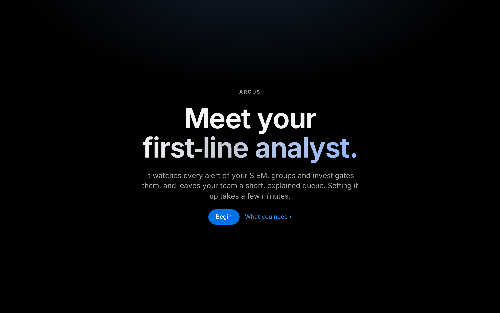 <b>Set it up</b>: the first-time setup, in the browser</td>
    <td width="50%">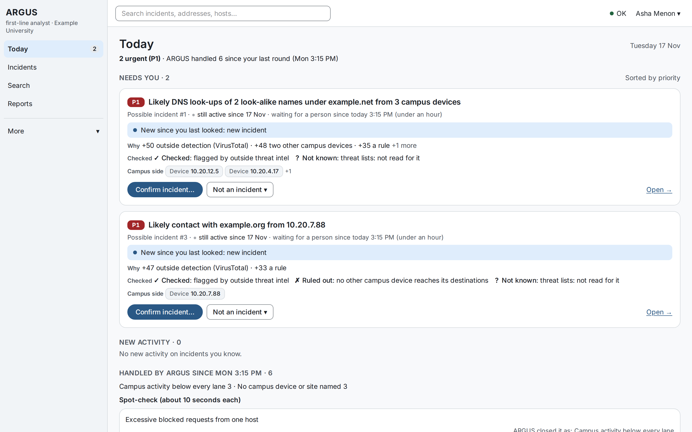 <b>Then work the queue</b>: Today, what needs a person</td>
  </tr>
</table>

**Contents**

| Area | Capabilities |
|---|---|
| [Taking in alerts](#taking-in-alerts) | collector, backfill, reconciliation, quarantine, address labels |
| [Grouping](#grouping) | investigations, versions, patterns, rules registry |
| [Investigating](#investigating) | evidence packs, dossiers, threat intel, outside lookups, sign-in attribution, the investigation wave, Check more, freshness |
| [Deciding](#deciding) | decision engine, safety floor, AI investigator, proposals, gold set, tuning |
| [Cases and incidents](#cases-and-incidents) | suggested cases, campaigns, the case lifecycle, known infections, incident reports, block lists, recommended actions, the still-active watch |
| [People](#people) | the web app, reviews, approvals, users and roles, ELK sign-in, the emergency account, daily and weekly reports, notices |
| [Kibana](#kibana) | read-back, the case team, alert status write-back |
| [Protecting the SIEM and the data](#protecting-the-siem-and-the-data) | the Elastic Gateway, the LLM gateway, the privacy layer, the audit trail |
| [Operating it](#operating-it) | one-command install, the first-time setup, Settings, discovery, doctor, units, backups, retention, kill switches |

---

## Taking in alerts

| Capability | What it does | Default |
|---|---|---|
| **Collector** (`argus-collector`) | Polls one Kibana space's Security alerts **every minute** (new since the last cursor), refreshes their workflow status every 15 minutes, and probes the SIEM's health every minute. | on |
| **Backfill** | On first start, takes in `history.window` (5 days by default) of past alerts, newest hours first; resumes where it stopped. | on |
| **Reconciliation** | Every hour compares the last whole hours of alerts in the SIEM with ARGUS's store and repairs any gap, so nothing is missed after an outage. | on |
| **Normalisation and quarantine** | Each alert becomes a typed record; one that cannot be read is **quarantined** with the field that failed, never dropped silently. | on |
| **Address labels** | Every address is labelled: one of your own networks (`site.own_networks`, private ranges), an entry of your [asset map](llm.md#10-the-asset-map) ("a lab machine in building B"), or the outside world. | on |

Commands: `argus collect status | once | backfill | reconcile`.

## Grouping

| Capability | What it does |
|---|---|
| **Investigations** | One investigation = one rule + one *actor* + one day (in your time zone). The actor's key comes from the rule's own alert suppression (`group_by`), a threshold rule's field, `config/grouping.yaml`, else the source and destination addresses. A thousand alerts a day typically become a few hundred investigations. |
| **Versions** | A new alert in an existing investigation makes a new version, which is queued for evidence again. |
| **Patterns** | Alike investigations (same rule, same evidence shape, same day) form a **pattern** that a reviewer can decide at once, and that the AI investigator reads once. |
| **Rules registry** | The detection rules ARGUS knows from their alerts, with each rule's own investigation notes turned into steps (`argus rules list`). |

## Investigating

### Evidence packs and dossiers (`argus-worker`)

For every investigation version a deterministic graph (LangGraph, **no AI**) gathers evidence: the
stored alerts first, then a few small, bounded queries through the gateway, chosen by the **role**
of your log families (`site.families`: `proxy`, `web`, `dns`, `auth`, `mail`, `other`):

| Pack | Log role | What it asks |
|---|---|---|
| **Generic** | all | The rule's own steps, each answered; the distinct values of the fields those steps name; the asset map's view of every address |
| **Proxy** | `proxy` | What an internal host reached in the alert's hours (destinations, bytes, answers, a 10-minute timeline) and how many hosts reached an outside destination; whether a host repeats like a **beacon** (period, jitter, last beat) |
| **Web** | `web` | What an attack on your sites tried (decoded paths, scanner user agents, path categories) and **whether the client then got a successful answer** |
| **DNS** | `dns` | The names one client looked up in up to two hours: most and least asked, distinct names, query types, answer codes (a DNS tunnel shows here) |
| **Threat intel** | your TI indices | The indicators in your threat-intel sources, which other investigations name a listed indicator |
| **History** | all | The entity's earlier alerts and investigations over `history.window` |
| **Sign-ins** | `auth` | Who signed in from an internal address around the alerts ([below](#sign-in-attribution)) |
| **Outside** | public indicators | VirusTotal, Shodan, Censys (optional keys, [below](#outside-threat-intel)) |

The result is a **dossier**: every fact with its source and the exact query behind it, every
signal as "known" or "could not tell, and why". **A missing log is *unknown*, never *clean*.**

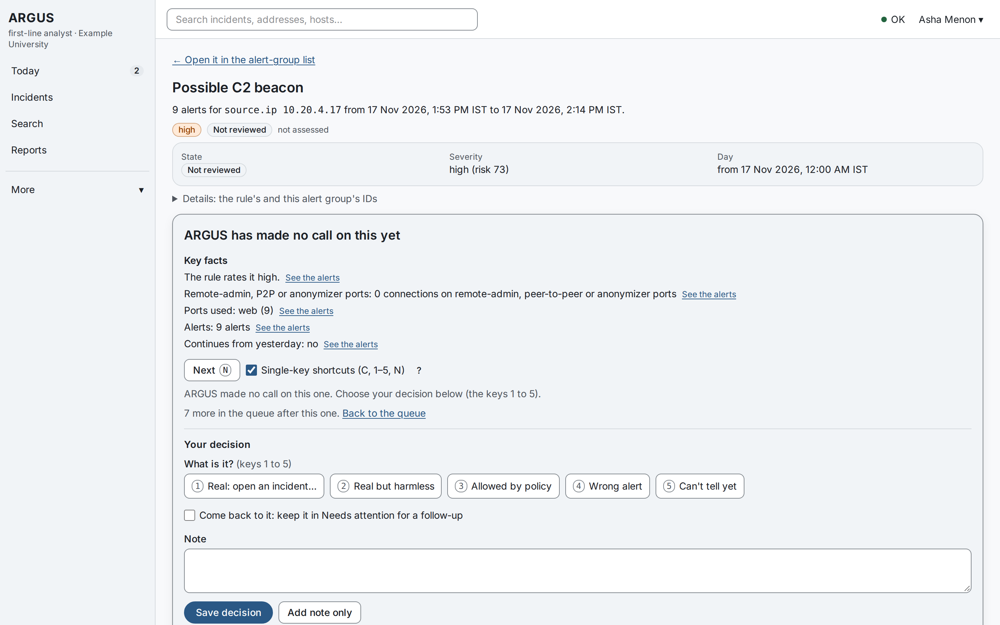

### Threat intel

Your own threat-intel indices, configured per site (`site.ti_sources`, up to 8), in one of two
schemas: `ecs` (ECS `threat.indicator.*`, what Elastic's Threat Intel integration writes) or `ioc`
(`ioc_type` / `ioc_value` / `intel_source` rows), and one of two modes:

- **`mirror`**: a small index read whole into ARGUS's store every 6 hours (`reference.ti_sync`);
- **`lookup`**: the values an investigation needs, asked as needed and cached for a day.

A source whose newest indicator is older than 7 days is **stale**: a miss in it is "could not
tell", never "clean". Commands: `argus ti status | lookup VALUES | sync`.

### Outside threat intel

Optional, with your own **free** keys pasted in **Settings → Outside sources** (stored in
`.env`), for **public** addresses and names only (a private or own address is never sent):

| Source | Answers | Key |
|---|---|---|
| VirusTotal | how many engines flag an address or domain | `ARGUS_OUTSIDE__VIRUSTOTAL_API_KEY` |
| Shodan | open ports, software, names, known CVEs of a public server | `ARGUS_OUTSIDE__SHODAN_API_KEY` (without it: Shodan's free InternetDB) |
| Censys | the same, as a second source | `ARGUS_OUTSIDE__CENSYS_API_KEY` (a Platform personal access token) |

Answers are cached for 7 days ("no record" for a day), every source stays below its free plan
(VirusTotal 3 a minute and 400 a day; Shodan 200 a day; Censys 10 a day and 50 a month), and a
`429` stops that source until it may ask again. A VirusTotal detection counts as a danger sign
like a threat-list hit. How to get the keys: [llm.md](llm.md#36-other-optional-keys-outside-threat-intel).

### Sign-in attribution

Who was behind an internal address? With an `auth` log family (single sign-on logs), ARGUS reads
the sign-ins for the addresses of its active investigations (a few requests a pass, NORMAL health
only, never in the quiet hours) and keeps the accounts per address and day (180 days). For one
investigation it says one of: **likely** (exactly one account), **possible** (two or three),
**shared** (a lab or NAT: counts only, no guess), **none seen**, or **unknown** (and why).
User names are shown only to people with `see_logs` and are **never sent to a model**. Setting:
`signins.enabled`; runbook: [runbooks/signins.md](runbooks/signins.md).

### Deeper evidence on demand

| Capability | What it does | Default |
|---|---|---|
| **Check more** | A reviewer asks one approved, read-only question to the SIEM about one host or address from an investigation or case page; its cost is shown first. | on |
| **The investigation wave** | For an undecided investigation with a gap a query could close, ARGUS asks the ranked checks itself (NORMAL health only, inside its own lane) **before** any model is asked. | off (`investigation.wave`) |
| **Evidence templates** | Further aggregations (beacon timing, DNS per host, web path outcomes, source events), each switched on only after its first production run passed within its limit (`argus worker template-check`). | off (`enrichment.templates`) |
| **Freshness** | Watermarks per log source, so "nothing found" can be told from "the logs were not in yet". | off (`freshness.mode`) |

## Deciding

| Capability | What it does |
|---|---|
| **Decision engine** | Proposes an outcome only where your reviewers' past verdicts on the same kind of alert agree: at least 5 labels, 95 % alike, none older than 30 days, and for a benign outcome no true positive among them. It relearns every pass. No AI. |
| **Safety floor** | Never proposes "benign" while a threat-list hit, an outside detection, success after an attack, a regular beacon, a rare destination, a remote-admin, P2P or anonymiser port, high or critical severity, a first-seen entity or a volume spike is present, **or not known**. |
| **AI investigator** (optional) | Takes what the engine leaves open, once per pattern a day: a lead agent and web, proxy and threat-intel specialists read the pseudonymised dossier, may run a fixed list of read-only checks, and answer with a verdict, a confidence, hypotheses and cited facts. Code checks every citation and the floor. See [agents.md](agents.md) and [llm.md](llm.md). |
| **Proposals** | Outcomes that pass become proposals, grouped by what decided them, each group with a random audit sample: a person confirms a group in one click. A proposal is never a review: nothing is "reviewed" without a person. |
| **ARGUS's reading** | An AI answer that cannot be a proposal (a citation not found, the floor engaged) is still shown, with the reason. |
| **Gold set** | Your reviewers answer a fixed sample once; it scores the engine and the AI (`argus gold score`) and gates every change to the AI's prompts. |
| **Rule tuning** | A weekly per-rule report: alerts a day, investigations, runs that hit the rule's limit, people's labels, the dominant values; with a model, drafted suggestions to make a noisy rule quieter (you apply them in Kibana; ARGUS never edits a rule). |

## Cases and incidents

| Capability | What it does |
|---|---|
| **Suggested cases** | Every 15 minutes ARGUS suggests cases from evidence across investigations: a **campaign** (several of your devices reaching one flagged destination, or destinations of one operator), a **host flagged by several rules** or on several days, or **actors hitting the same rare targets**. A suggested case is *suspected* until a person confirms or dismisses it; a dismissal stands. |
| **Case lifecycle** | suspected → open → assigned → contained → closed, with take, assign, release, contain, link, split, merge, retitle and reopen; every move is a person's action except ARGUS's own suggestions and links, and the database enforces the same edges. Activity after closure opens a linked new case, never reopens the old one silently. |
| **Known infections** | Once a person records that a device's owner was told (*notified*), new alerts from that device about the same things join the case **silently** and are counted; only something new (a new flagged destination, a new kind of evidence, much more traffic) is raised. Reminders after 7 and 21 days; a proposal to close after 14 quiet days. |
| **Incident report** | For each suggested or open case, a report written by code from ARGUS's database: summary, verdict with confidence, timeline, actors and affected assets, evidence (each line with its query and a Discover link), hypotheses, indicators, recommended actions. Every number in a sentence must come from a cited fact. As a **page**, a **PDF** (with a one-page dashboard of charts) and two **CSVs** (indicators, affected devices). Optionally a model rewords the summary (`incident.prose`). |
| **Block list** | A case's ready block list: its public domains, their registered parents and addresses, with the outside evidence for each, as CSV or plain text for an e-mail; shared infrastructure (CDNs, cloud networks) is never on it (`argus case blocklist`). |
| **Recommended actions** | A fixed catalogue (`config/actions.yaml`) of actions per kind of incident, each with an owner and how its "done" can be checked; ARGUS records who was asked and verifies reported "done" from the logs where it can (`argus case actions`). |
| **Still-active watch** | Once a day, for every open true-positive case: did it alert again, and (with `cases.watch: on`) did the proxy logs show contact? "Contained" needs three quiet days and a person's attestation. Off by default ([runbooks/case-watch.md](runbooks/case-watch.md)). |

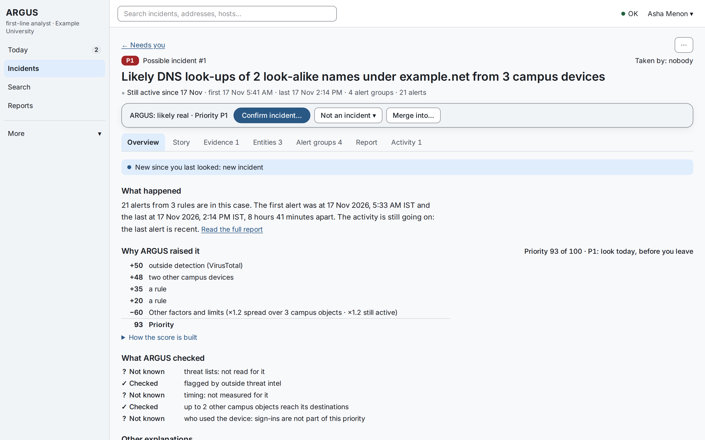

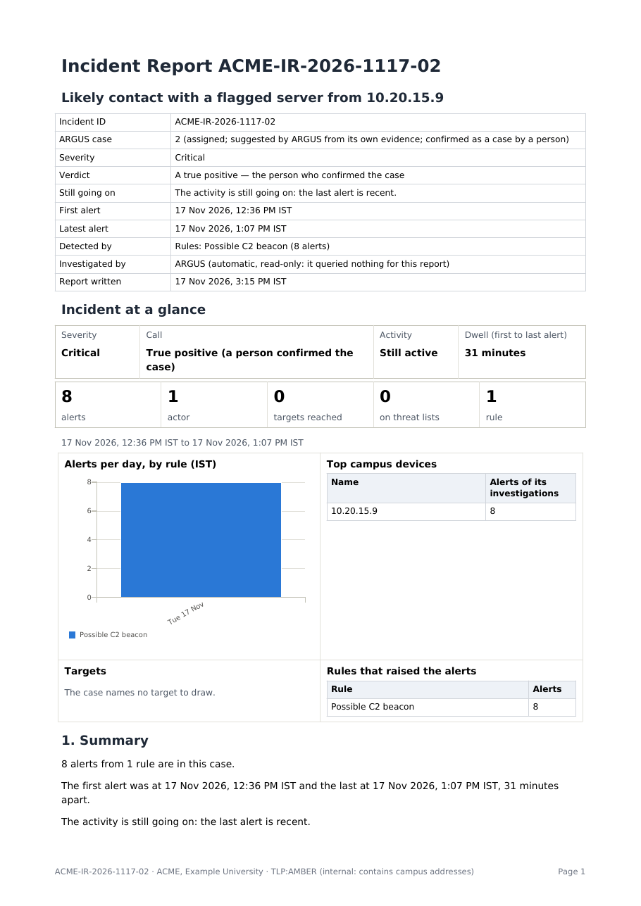

## People

### The web app (`argus-web`)

A calm web app for reviewers and for whoever runs ARGUS (React, light and dark from the system
setting, keyboard navigation):

| Menu | Pages |
|---|---|
| **Main** | **Today** (what needs a person today, and what ARGUS handled on its own), **Incidents**, **Search**, **Reports** |
| **More** | Overview, **Approvals**, Rule tuning, ARGUS quality (what the AI did, what it cost, the gold set), System health (whether data is arriving; a gap is *unknown*, never *clean*), Help & glossary |
| **More queues** | **Patterns**, **Proposals** |
| **Administration** (administrators) | **Settings**, **Users and roles**, Design system |

Every change ARGUS composes for a person shows **the exact request first**; if someone else changed
the item meanwhile nothing is saved. Text from logs, alerts, Kibana or a model is always shown as
text. Details: [web-ui-guide.md](web-ui-guide.md); the reviewers' one-page guide:
[guide-ta-ra.md](guide-ta-ra.md).

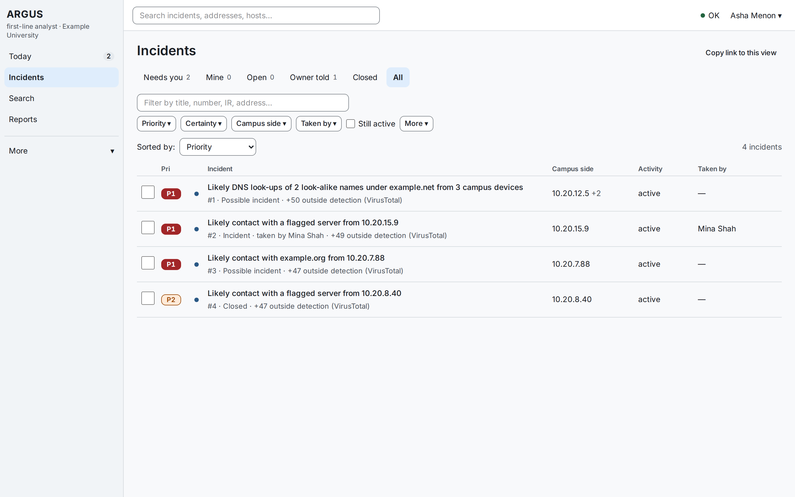

### Accounts, approvals and sign-in

| Capability | What it does | Default |
|---|---|---|
| **Users and roles** | Local accounts made in the app: four roles (Viewer, Analyst, Lead, Administrator) or a custom set of eight capabilities (`view`, `see_logs`, `review`, `answer_gold`, `manage_cases`, `reopen`, `approve`, `admin`). A new person gets a one-time link (72 hours) to choose their own password; an administrator never sees it. Accounts are switched off and on, and sessions ended, from the same page. Passwords hashed with Argon2; failed sign-ins slow down and lock; sessions end after 30 minutes idle or 8 hours. | on |
| **Two-person approvals** | Closing or merging a case is one person's request and **another person's approval** (with the password re-typed); a closure for a real incident needs two different approvers. Approvals are signed with a key. | on (needs the approval key) |
| **Sign in with ELK accounts** | People use their own Elasticsearch/Kibana accounts; each capability is derived from what the account **actually holds** (actions, never role names) and re-checked during the session; superusers and admin accounts are refused. | off (`web.elk_signin`) |
| **Emergency account** | With ELK sign-in on, a one-time view-and-review account a person switches on at the ARGUS machine while ELK is down (`argus break-glass`, on the server only). | off |

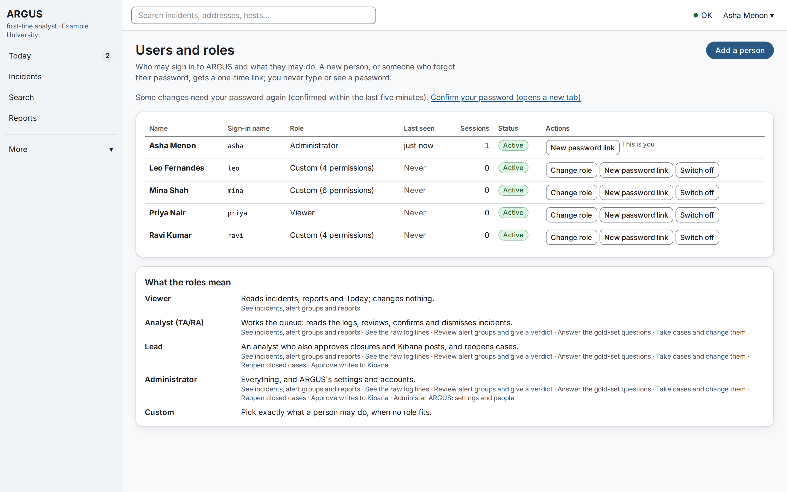

### Reports and notices

| Capability | What it does | Default |
|---|---|---|
| **Daily and weekly reports** | Made from ARGUS's database only (no SIEM request, no model) at 02:15 UTC daily and Mondays 02:20 UTC: what happened in the period, what is waiting now, each figure with its definition. Optionally one plain paragraph from the reporter agent (off). | timers installed, enable to run |
| **Report per investigation** | `argus report show`: what the alerts alone said, what every extra query found, and how the assessment decided. | on |
| **E-mail notices** | A link, a severity and a count (never a name) for five triggers: a confirmed case still active, activity after closure, a closure waiting more than 12 hours, a high-confidence indicator on one of your hosts, an outage of an hour. At most 10 e-mails an hour, through your relay. | off ([runbooks/notices.md](runbooks/notices.md)) |

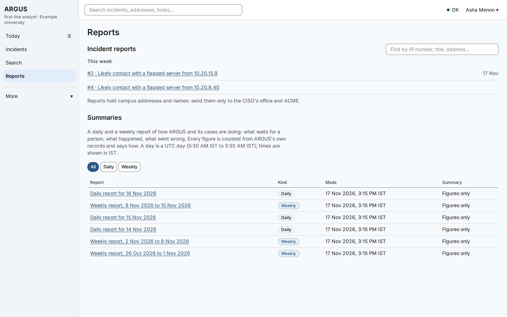

## Kibana

| Capability | What it does | Default |
|---|---|---|
| **Read-back** (`argus-kibana-sync`) | Reads the Kibana cases that hold ARGUS's alerts (and the case team's), what people did to them, and `Verdict:` comments, every 10 minutes when the SIEM is NORMAL. | on where Kibana is configured (the first-time setup starts it) |
| **Discover links** | Every evidence line of an incident report opens its query in Kibana Discover. | on |
| **The case team** (`WC`) | Posts a person-confirmed incident case to Kibana as **seven Kibana users**, each owning one part (lead, evidence, visualiser, intel, responder, hunter, reporter), with the PDF and CSVs in the case's Files tab and live charts of its alerts. ARGUS creates its own users and keys with one command. See [case-team.md](case-team.md). | **off** |
| **Alert status write-back** (`WA`) | After people's reviewed verdicts, closes (benign, policy, false positive) or acknowledges (true positive, follow-up) those alerts, a few a minute, reading back each change. | **off** |

Every write class needs its own key in the writer's own credentials (never `.env`), its name in
`kibana.write_classes`, the write window and NORMAL health, and a person present for its first
run. ARGUS never edits or disables a rule, never deletes a case or an alert, and never writes to a
case it did not create. See [kibana.md](kibana.md).

## Protecting the SIEM and the data

| Capability | What it does |
|---|---|
| **The Elastic Gateway** | The one door to Elasticsearch and Kibana. Requests are fixed **templates**, validated against allowlists (clauses, sizes, time range, the site's indices only); a **budget of server time** (60 minutes a day by default, split into lanes); **health states** (NORMAL, CAUTION, DEGRADED, STOP) from a probe every minute; **quiet hours** (00:00–01:30 UTC by default); an **overload breaker** (5, 15, 60 minutes); **kill switches** per component; a **ledger** of every request; pinned TLS. See [architecture.md](architecture.md#the-elastic-gateway). |
| **Read-only by default** | The SIEM key holds no write privilege; `argus init` checks it with `_has_privileges` and stops if it does. |
| **The LLM gateway** | Free providers first, the paid one last; per-provider limits, cool-downs and breakers; daily and monthly cost caps; a kill switch; a ledger of every call without its content. See [llm.md](llm.md) and [costs.md](costs.md). |
| **The privacy layer** | Default-deny data policy per dossier field; internal addresses, hosts, users and your domains become per-item pseudonyms; counts rounded, times relative, untrusted text cleaned and capped; a byte-by-byte egress validator; re-identification in memory only. Sign-in user names and reviewers' notes are never sent. |
| **Least privilege in the database** | Separate PostgreSQL roles: the schema owner, the runtime login the services share (no superuser, owns nothing), the web's own login, the writer's own login, a purge role. `argus doctor` checks every grant. |
| **The audit trail** | Every verdict, change, approval and switch is an append-only audit event in two hash chains (a trigger refuses every update and delete); `argus audit verify` checks every row. |
| **Secrets** | Only in `.env` (mode 600), the LLM keys file (mode 600) or credential files; registered for redaction from every log line; doctor fails if a write key is in a shared place. |

## Operating it

Install with one command, then run ARGUS from the web app: settings, people and roles, the AI
providers and their keys, the threat-intel keys, the asset map, connection checks, costs and the
kill switches. The server is left with upgrades, restoring a backup, the emergency account, and
recovery when the web itself is down ([operations.md](operations.md#what-stays-on-the-server)).

| Capability | What it does |
|---|---|
| **One-command install** | `./install.sh` (needs uv and Docker with compose): the database with generated passwords, the web's certificate, one question (the address people open ARGUS at), the web and `argus-admin` started, and a one-time link (72 hours) for the first administrator. [install.md](install.md) |
| **First-time setup** | In the browser, one question per chapter: your organisation; the SIEM (ARGUS reads the certificate it presents and shows the fingerprint to compare); access, either an Elastic administrator's login that ARGUS uses once to make its own read-only keys and, if asked, the Kibana case team's users (never stored), or pasted read-only keys; Kibana (optional); AI and threat-intel keys and the asset map (each optional); review and run. `argus-admin` then runs the rest of the installation, discovery included, starts every service and stores the extra keys, showing its progress. |
| **Settings** | Every setting with its help, in sections; a change is checked again and applied by `argus-admin`, which restarts only what reads it and **rolls back** if a service does not come back. Keys and addresses need the password again; anything that lets ARGUS write to the SIEM also needs a typed confirmation. Keys are sealed and never shown again. The SIEM load budget is shown, not changeable. [configuration.md](configuration.md#changing-a-setting-in-the-app) |
| **AI and agents** | Each AI provider (free first, paid last): its models, its keys (*Set* or not; added in the app, sealed, never shown again), an On switch, a **Test** (the model list, no prompt), its own limits and spend; the overall monthly and daily limits; each AI task's calls a day, providers and model size; **Stop all AI calls** and Resume. The agents: what each does, its model size, tools, triggers, version and whether it runs; the case team's Kibana users and their keys. |
| **Threat intel** | VirusTotal, Shodan and Censys: each key added and tested in the app (one lookup of a public test address, counted under the free plan's limits like ARGUS's own), each plan's limits, today's and this month's lookups; Shodan's keyless InternetDB as a fallback. |
| **Costs and usage** | The AI's spend a day for 31 days by provider, by task this month, against the caps; each threat-intel source's lookups a day against its daily limit. |
| **Connection checks** | From Settings: the SIEM's key (`siem selftest`: TLS pin, version, privileges) and each Kibana key (`kibana selftest`), run by `argus-admin`, the result shown on the page. |
| **Settings history** | The last fifty changes: when, who, which setting, applied, refused or rolled back and why. |
| **`argus init`** | The same installation from the terminal, in ten steps, interactive or scripted (`--answers FILE`): prerequisites, `.env` with generated database passwords, PostgreSQL in Docker, the CA pin, the read-only keys (it prints the exact Dev Tools request), the organisation, discovery, the LLM keys, the web, the systemd units, then doctor. Rerun at any time: it keeps what is done. Also used for upgrades. [install.md](install.md) |
| **Discovery** | `argus discover` proposes your site (log families and their roles, the Kibana space, threat-intel sources, versions, Kibana feature ids) from **metadata only**: index names, aliases, mappings; it never reads a document. [runbooks/discover.md](runbooks/discover.md) |
| **`argus doctor`** | On the server: every part, offline, each problem with its fix: configuration, database and grants, migrations, site, CA and key expiry, agents, LLM keys, privacy, units, backups, write keys, the web's certificate. |
| **systemd units** | `argus units install` renders the unit templates for this checkout and this uv, with memory caps and low CPU priority, shows the diff and installs them as user units. |
| **Backups** | A nightly `pg_dump` with fingerprints (21:30 UTC), a weekly **restore drill** into a scratch database comparing every table (Sundays 22:00 UTC), retention of nightly, verified, migration and manual dumps, and optionally a dump before every
migration (`backup.before_migration`). `argus backup check` does a dump and its drill now. |
| **Retention** | A purge with a dry-run plan per table (`argus purge plan`), raw alert sources after 30 days, everything after `memory.window` (90 days) unless held. Scheduled deletion is off until you decide. |
| **Kill switches** | In the app: **Stop all AI calls** (AI and agents). On the server: `argus siem stop` (all, or one component), `argus llm stop`, `argus kibana resume` after a pause: effective at once, resuming the SIEM needs the database owner. |
| **Status at a glance** | In the app: System health and the status in the header. On the server: `argus siem status`, `collect status`, `worker status`, `assess status`, `llm status`, `kibana state`, `case team status`, `admin status`. |

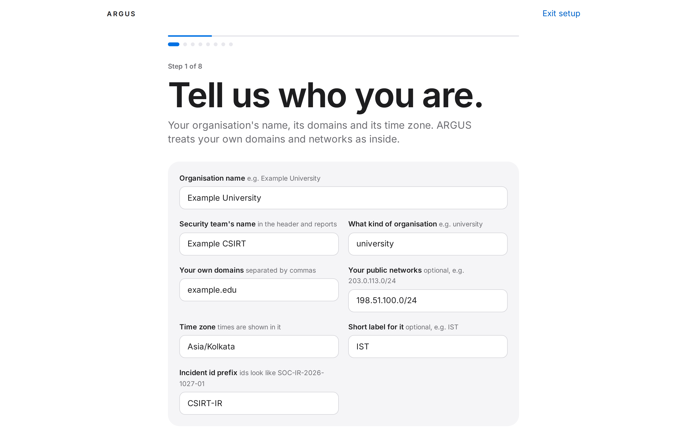

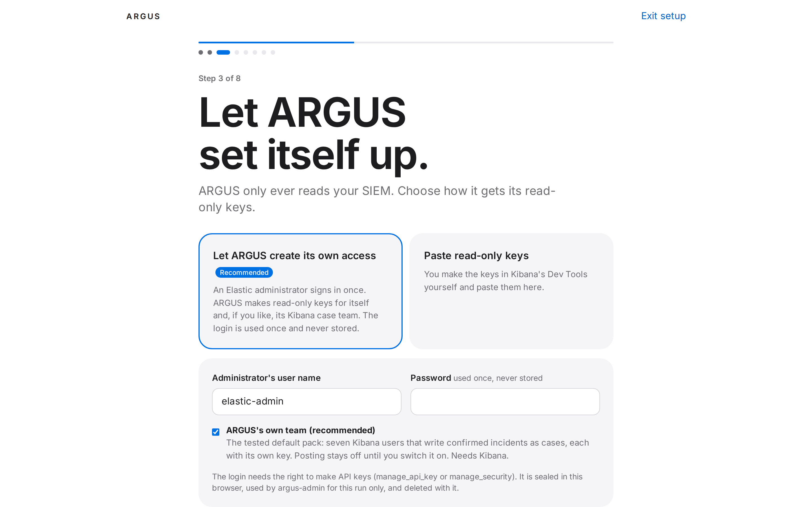

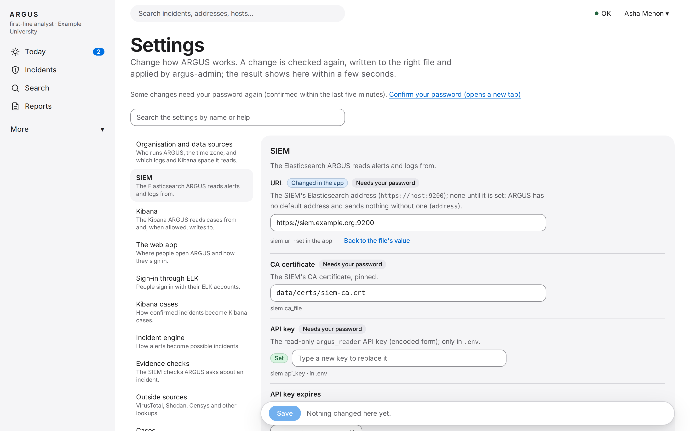

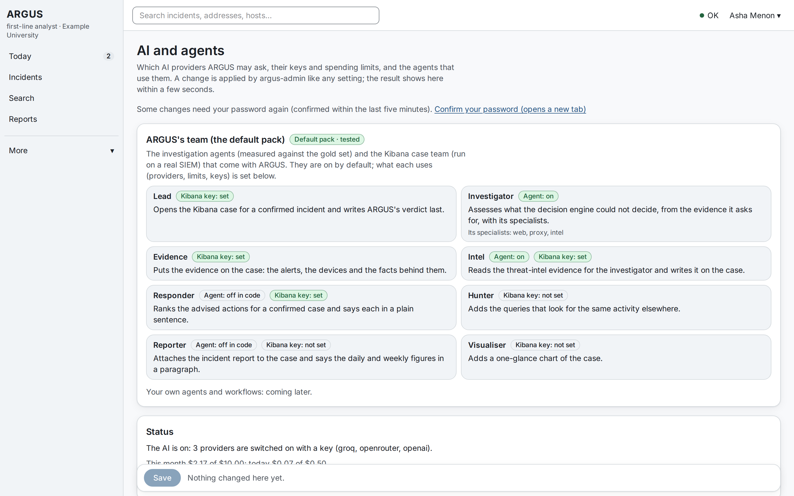

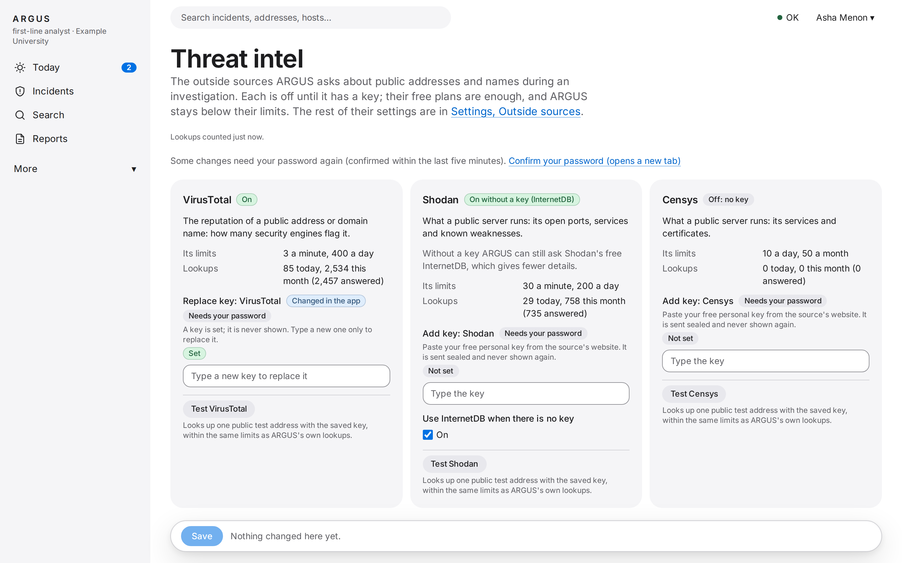

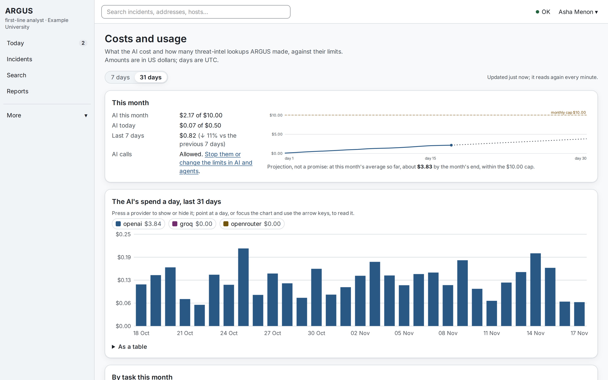

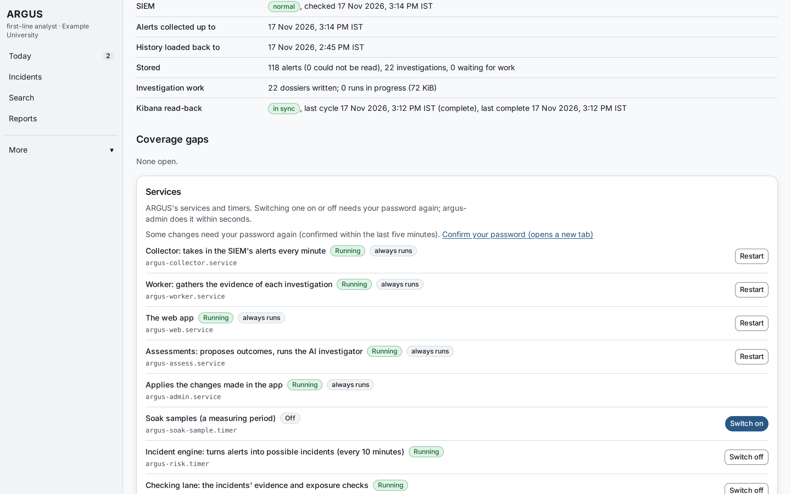
