# Web UI Guide

The ARGUS web app is where people meet ARGUS's work (what needs attention, incidents with their
evidence, ARGUS's proposals, approvals and reports) and where an administrator runs ARGUS:
the first-time setup, every setting, and the people who may sign in. This page is for whoever
sets it up and administers it. The guide for the people who review alerts every day is
[guide-ta-ra.md](guide-ta-ra.md) (written for reviewers: research and teaching assistants in the
original deployment, analysts anywhere).

**Contents**

- [Opening it](#opening-it)
- [Signing in](#signing-in)
- [Administration](#administration)
  - [Settings](#settings) · [AI and agents](#ai-and-agents) · [Threat intel](#threat-intel) ·
    [Costs and usage](#costs-and-usage) · [Services](#services) ·
    [First-time setup](#first-time-setup)
- [Users and capabilities](#users-and-capabilities)
- [The pages](#the-pages)
- [How changes are made](#how-changes-are-made)
- [Approvals](#approvals)
- [Sign in with ELK accounts](#sign-in-with-elk-accounts)
- [The emergency account](#the-emergency-account)
- [The API](#the-api)
- [Troubleshooting the web](#troubleshooting-the-web)

---

## Opening it

`./install.sh` asks one question, the address people open ARGUS at, and serves the app there
over HTTPS on port **8765** (`https://<address>:8765/`), with a certificate it made itself
([install.md](install.md#install-in-two-steps)). Left empty, the app stays on
**`127.0.0.1:8765`**, reachable through an SSH forward:

```bash
ssh -L 8765:127.0.0.1:8765 argus@argus-host.example.org
# then open http://127.0.0.1:8765/
```

To use your own certificate, or to change the host names and networks allowed: allowed hosts and
networks are in **Settings → The web app**; the certificate itself is the server's
([install.md](install.md#73-your-own-certificate-and-the-firewall)).

The app lives at `/app`; the address `/` and every older page address lead to the same thing in
the app (links in Kibana cases and notices keep working). Light and dark follow the browser's
system setting. It is tested in current Chromium (Chrome, Edge) and Firefox.

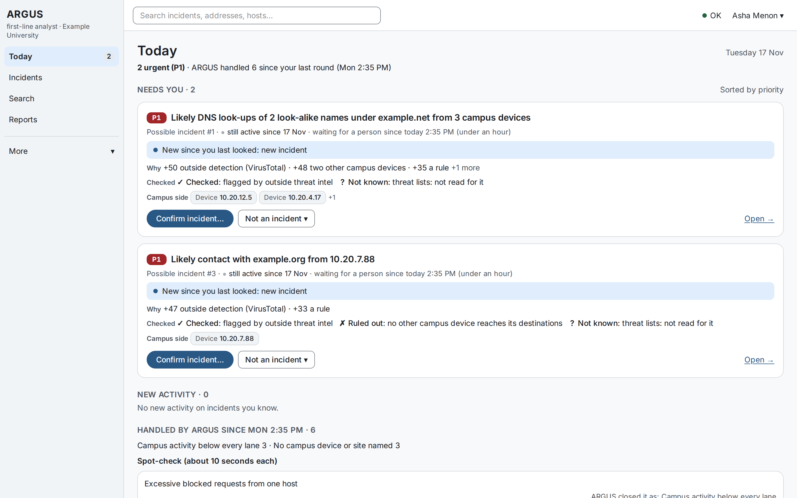

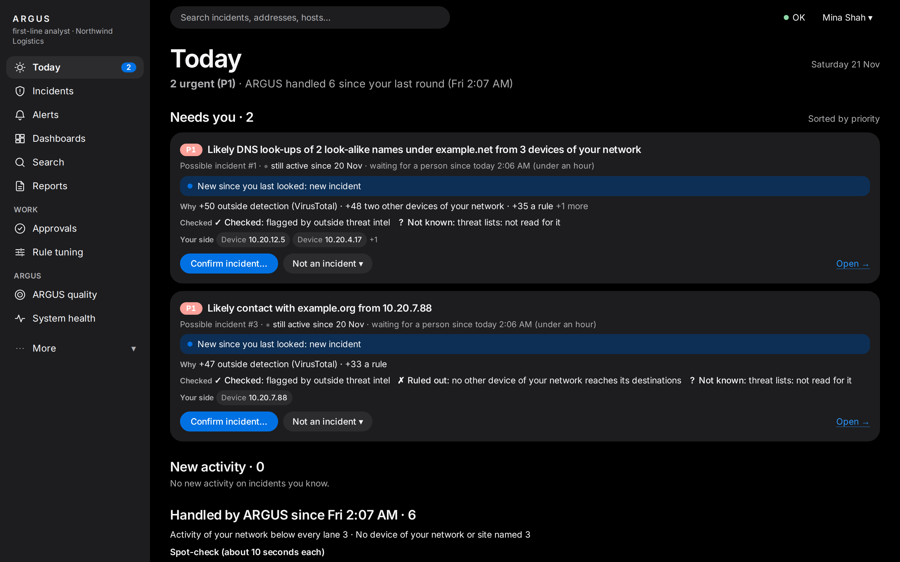

## Signing in

The sign-in page is `/signin`. People sign in with **local accounts** made in the app
([Users and capabilities](#users-and-capabilities)), or with their own ELK accounts
([below](#sign-in-with-elk-accounts)).

- **The first administrator** (`admin`) sets a password through the one-time link
  `./install.sh` prints (`https://<address>:8765/welcome?token=…`, valid 72 hours). Lost it, or it
  ran out? Run `./install.sh` again on the server: it keeps everything done and prints a new one.
- **Everyone else** gets a one-time link from an administrator (Users and roles → *Add a person*,
  or *New password link* to reset one) and chooses their own password at `/welcome`. Nobody else
  ever sees or types it.

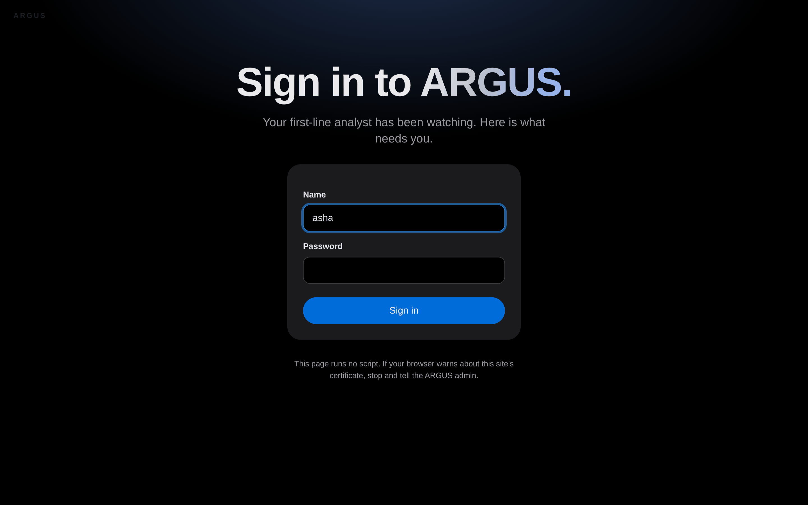

- **Failed sign-ins** slow down: after a second refusal the next check of that name from that
  client waits 1 s, then 2, then 4; the fifth refusal within 15 minutes locks the name for a
  while. Every failure gets the same answer after the same delay, so a wrong name cannot be told
  from a wrong password.
- **Sessions** end after 30 minutes without a request of the person's (the status bar's own
  refreshes do not count) and 8 hours after sign-in in any case (`web.session_idle`,
  `web.session_absolute`, in Settings → The web app).
- **Step-up:** approving, changing a sensitive setting and managing people ask for the password
  again (*Confirm your password* opens a new tab; it holds for five minutes).
- **Never past a certificate warning.** Tell reviewers to stop and report any certificate warning
  instead of clicking through.

## Administration

Administrators find these under **More → Administration**: **Settings**, **AI and agents**,
**Threat intel**, **Costs and usage**, **Users and roles** ([next section](#users-and-capabilities))
and the **Design system** (the app's colours and components, for developers). The services are a
panel on **System health**. Everything after the install is done here: the server is needed only
for an upgrade, a restore and recovery ([operations.md](operations.md#what-stays-on-the-server)).

Each change is saved as a request that the service `argus-admin` checks again and applies within
seconds; the page shows what became of it. If `argus-admin` is not running, the page says so and
your change waits for it. Keys and money limits need your password again (*Confirm your password*
opens a new tab, valid five minutes); a key is typed once, sealed in the browser's request and
never shown again, only replaced.

### Settings

Every setting of ARGUS with its help and current value, in sections (the SIEM, Kibana, the web
app, sign-in, notices, retention, backups, outside lookups, the incident engine and more), and a
search box over all of them. A save is applied by `argus-admin`, which restarts only what reads
the setting; if a service does not come back, the change is **rolled back** and the page says
why. Anything that lets ARGUS write to the SIEM also needs you to type *let ARGUS write to the
SIEM*. Full reference: [configuration.md](configuration.md#changing-a-setting-in-the-app).

- **Check the connection**: the *SIEM* section has a button that has `argus-admin` try the saved
  key against the SIEM (the certificate pin, the version, what the key may read); the *Kibana*
  section has one per Kibana key (read-only, cases, alerts). Nothing is changed. The result is
  **Passed** or **Failed**, with what the check said under *What it said*.
- **Upload an asset map**: in the *Asset map* section, choose your asset map file (`.yaml` or
  `.yml`, at most 5 MB). It is read in the browser, sent sealed with your password confirmed, and
  imported by `argus-admin`, which deletes its copy afterwards; the page shows **Imported** or
  **Not imported** with the importer's output. The format: [llm.md](llm.md#10-the-asset-map).
- **History**: the last entry of the section list. The last fifty changes made in the app, newest
  first: when, who, which setting, and whether it was applied, refused or rolled back, and why.

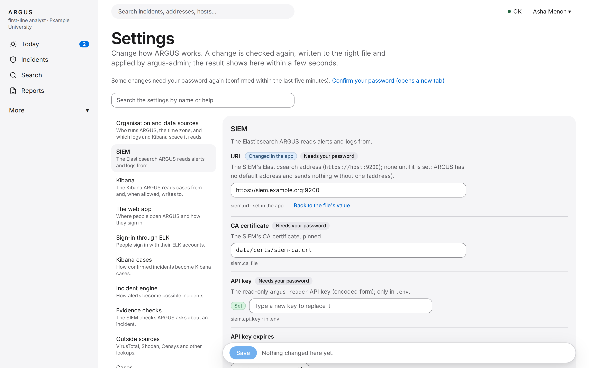

### AI and agents

ARGUS works without any AI. With a key for at least one provider it uses the AI for readings of
incidents, second opinions and the AI investigator, **free providers first**, paid ones last and
capped. The page, top to bottom:

- **Status**: whether the AI is on, this month's and today's spend, and **Stop all AI calls**
  (no call to any provider until you press **Resume AI calls**; recorded in the audit trail).
- **Spending**: the monthly and daily limits for the paid providers together (USD).
- **Providers**: one card each, free or paid, with its models by size, **Use this provider**,
  each key (*Set* or *Not set*, with **Add key** or **Replace key**), a paid provider's own limits
  and spend, this month's calls, any alarm, and **Test**: `argus-admin` asks the provider for its
  list of models with the saved key; no prompt is sent.
- **AI tasks**: the *ARGUS AI readings* switch, then each task's calls a day, the providers it
  may use in order, and the model size.
- **Agents**: what each agent does, its model size, tools, specialists, when it runs, its version
  and whether it is on. An agent's instructions are fixed and tested against the gold set before
  it runs: a new version comes with an ARGUS release, not from this page.
- **Case team**: the Kibana users that write confirmed incidents as cases, whose keys are set,
  and when they expire; the keys themselves are set in **Settings → Kibana cases**.

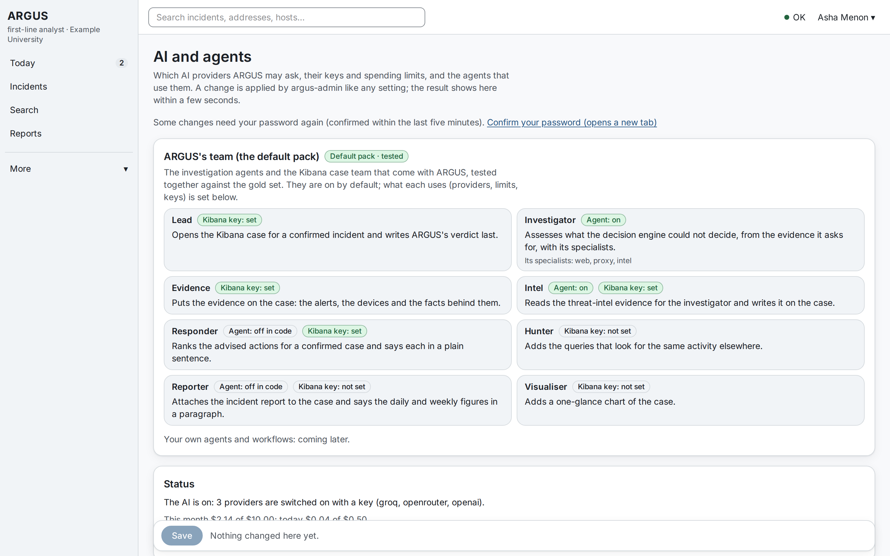

### Threat intel

VirusTotal (the reputation of a public address or name), Shodan and Censys (what a public server
runs). Each is **off until it has a key**; their free plans are enough, and ARGUS stays below
their limits. A card per source shows whether it is on, its limits, today's and this month's
lookups, **Add key** or **Replace key**, and **Test**, which looks up one public test address
(never one of yours) within the same limits as ARGUS's own lookups. Without a key ARGUS can still
ask Shodan's free InternetDB (fewer details): *Use InternetDB when there is no key*. Their other
settings are in **Settings → Outside sources**.

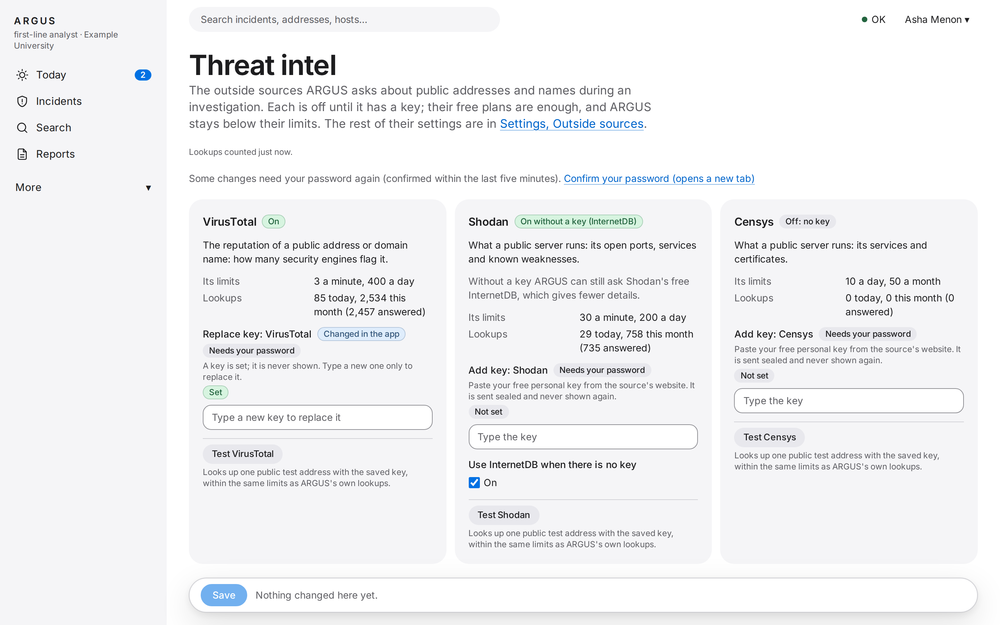

### Costs and usage

A read-only page. First the summary: what the AI cost this month and today against its limits,
and whether AI calls are allowed (with a link to **AI and agents** to stop them or change the
limits). Then the AI's spend a day for the last 31 days, stacked by provider (**As a table** under
it), the calls and cost by task this month, and each threat-intel source's lookups a day against
its daily limit (the dashed line). Amounts are in US dollars; days are UTC.

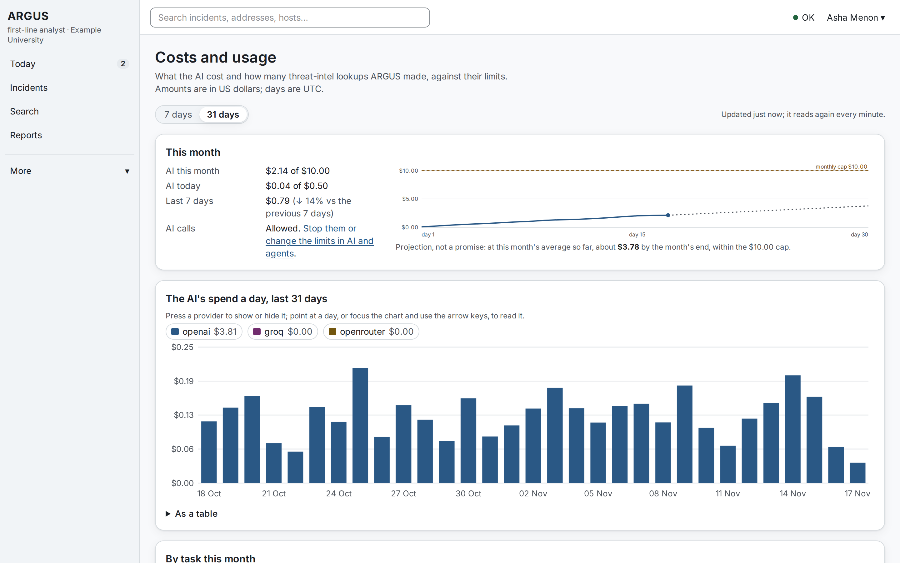

### Services

At the bottom of **More → System health**, administrators see ARGUS's services and timers: what
each does, whether it is meant to run and whether it runs, when `argus-admin` last looked, and the
badges *writes to the SIEM* and *deletes data*. **Switch on** and **Switch off** (for the optional
ones) need your password again; switching on one that writes to the SIEM also needs the typed
words. **Restart** restarts a service (not `argus-admin` itself, which applies the switch).

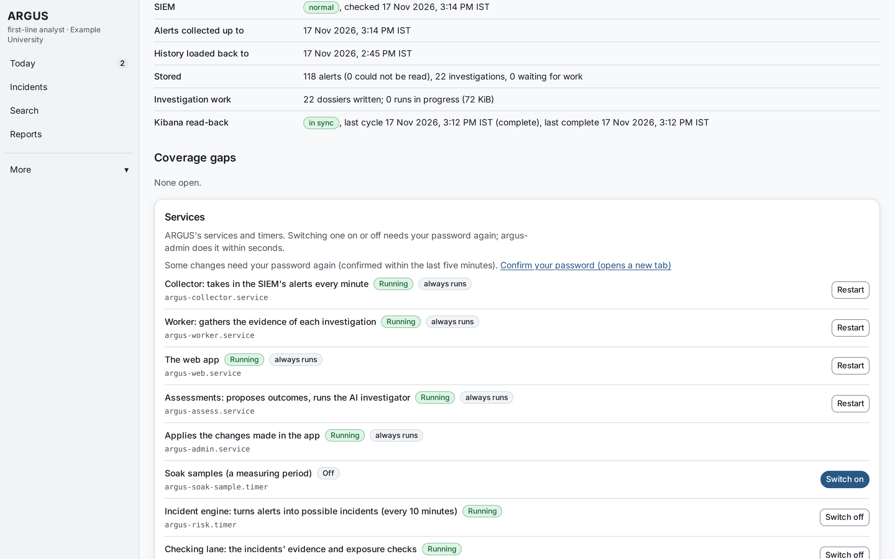

### First-time setup

The setup is not in the menu. Until ARGUS has its SIEM address and key, an administrator sees a
card on **Today**, *Finish the first-time setup*, whose **Start the setup** button opens
`/app/setup`; anyone else sees a calm card, *ARGUS is not set up yet*: an administrator still has
to finish it, and nothing is needed from them.

The setup has the whole screen: a start page, then one question per chapter, with a progress bar
and **Continue**, **‹ Back** and, for the optional chapters, **Skip ›**. **Exit setup** leads back
to Today; nothing is sent until the last chapter.

1. **Tell us who you are.** The organisation's name, the security team's name, what kind of
   organisation, your own domains and public networks (separated by commas), the time zone and a
   short label for it, the incident id prefix.
2. **Connect your SIEM.** Elasticsearch's address. *Check the certificate* reads what the address
   presents and shows the certificate authority's SHA-256 fingerprint; compare it with what your
   SIEM administrator gives you, then choose *Trust this certificate authority*, or *My system
   already trusts it* for a certificate from an authority this machine already knows. Then the
   index patterns of your logs.
3. **Let ARGUS set itself up.** Two ways:
   - *Let ARGUS create its own access* (recommended): an Elastic administrator's user name and
     password. ARGUS uses the login once to make its own read-only API keys (`argus-reader`, and
     with Kibana `argus-kibana-reader`, valid a year) and, if *Also make its Kibana case team* is
     ticked, the case team's two roles and seven users with a key each (posting stays off). The
     login needs `manage_api_key` or `manage_security`; it is sealed in the browser, used by
     `argus-admin` for this run only and never stored.
   - *Paste read-only keys*: the key you made in Kibana's Dev Tools and when it expires
     ([install.md](install.md)).
4. **Add Kibana.** *Connect Kibana* or *Not now*: its address and how its certificate is trusted,
   with pasted keys its read-only key, and the Kibana space with the Security alerts (found by
   itself when left empty). ARGUS writes nothing to Kibana until that is switched on in Settings.
5. **Bring your own AI. Or don't.** (optional) A key for any of the AI providers listed; they are
   stored after the setup, as on **AI and agents**.
6. **Add threat intel.** (optional) Keys for VirusTotal, Shodan or Censys, stored as on **Threat
   intel**.
7. **Map your network.** (optional) Your asset map file (`.yaml`, at most 5 MB), imported after the
   setup. ARGUS needs it before it asks an AI or an outside source about anything.
8. **Ready when you are.** What ARGUS will create in Elastic (with the login), every answer (keys
   only as "set"), then **Run the setup**, with your password confirmed again.

`argus-admin` then runs the rest of the installation with those answers: it checks the SIEM, makes
or checks the keys, discovers the log families and the Kibana space, writes the configuration,
starts every service, stores the AI and threat-intel keys and imports the asset map. The page
shows a checklist while it works and ends with **ARGUS is ready.**, what became of each extra key
and the asset map, and **Open Today**. If it stops, your answers are kept: fix what it names and
run it again.

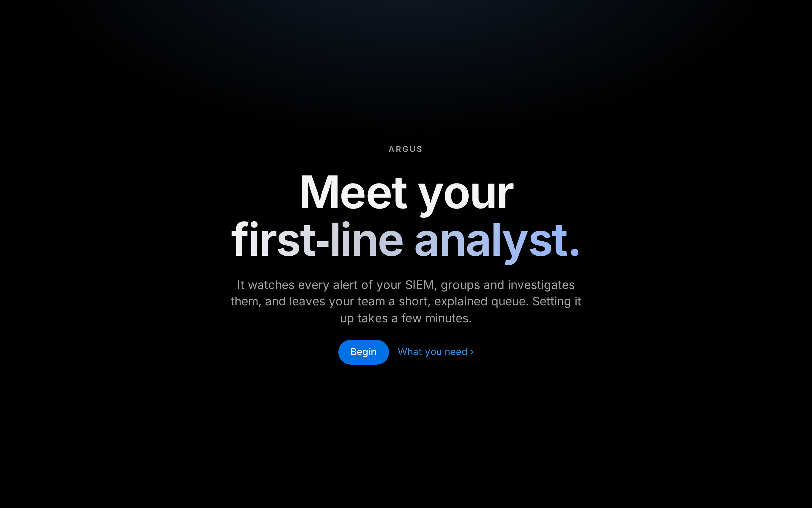

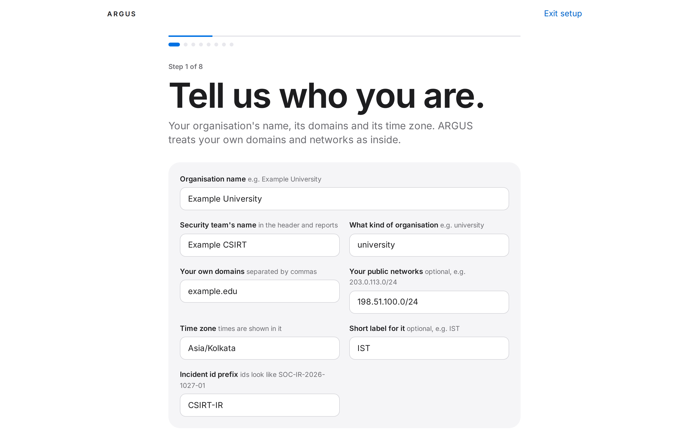

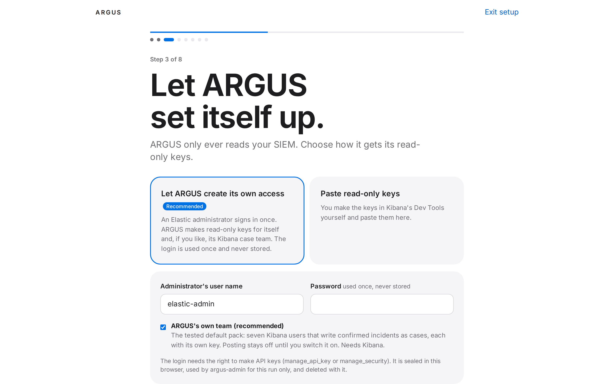

## Users and capabilities

**More → Administration → Users and roles** lists everyone who can sign in, with their role, when
they were last seen, their open sessions and their status. Each change asks for your password
again (within five minutes).

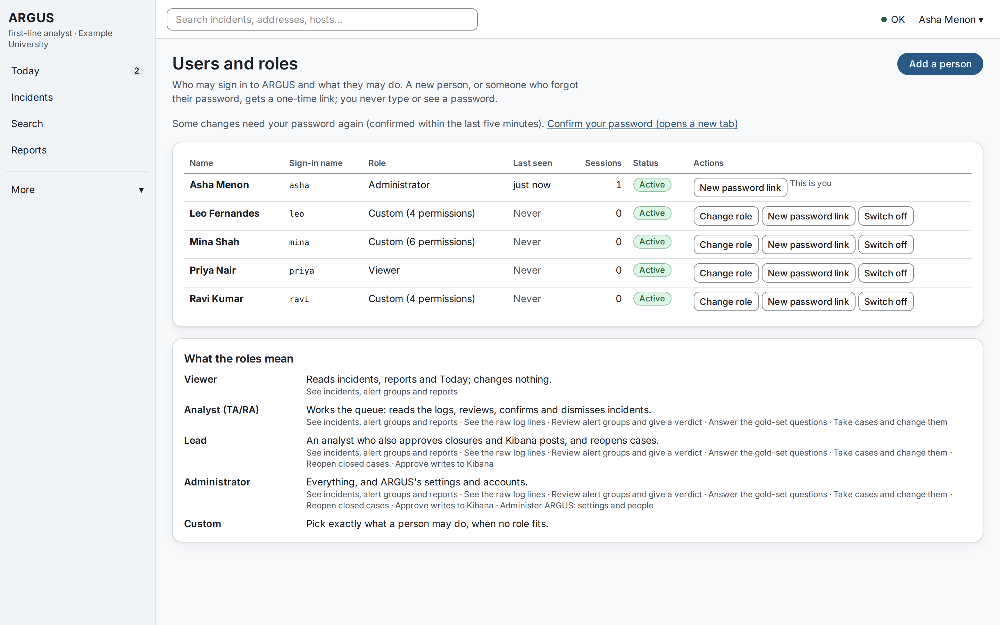

- **Add a person**: their name, a sign-in name (lower case, 2–32 characters) and a role. ARGUS
  shows a one-time link, valid 72 hours, which you pass on; they choose their own password with it.
- **Change role**: takes effect the next time the person's session reads its access (within a
  minute).
- **New password link**: a one-time link to choose a new password; an older unused link stops
  working.
- **Switch off / Switch on**: switched off, a person can no longer sign in and every open session
  ends; nothing they did is removed.
- **End sessions**: signs the person out of every browser now.

People who sign in through ELK are shown with an *ELK sign-in* badge; their access follows their
ELK roles and is changed there. The emergency account is changed only from the server
([below](#the-emergency-account)).

The roles:

| Role | What it gives |
|---|---|
| Viewer | `view`: reads incidents, reports and Today; changes nothing |
| Analyst (TA/RA) | `view`, `see_logs`, `review`, `answer_gold`, `manage_cases`: works the queue |
| Lead | an analyst who may also `reopen` and `approve` (closures and Kibana posts) |
| Administrator | everything, and ARGUS's settings and accounts (`admin`) |
| Custom | exactly the capabilities you tick, when no role fits |

| Capability | Lets a person | Needs |
|---|---|---|
| `view` | use ARGUS: see investigations, alerts and reports | |
| `see_logs` | see raw logs and the facts ARGUS read from them (and sign-in usernames) | view |
| `review` | review: verdicts, group reviews, accepting proposals, asking the AI | view |
| `answer_gold` | answer gold-set items | view, review |
| `manage_cases` | manage cases: take, assign, contain, request closure, merge, open | view |
| `reopen` | reopen a closed case | view |
| `approve` | approve closures and other requests, after confirming it is them | view, manage_cases |
| `admin` | change ARGUS's settings, run the first-time setup, manage people | view |

A capability counts only with its prerequisites; a grant whose prerequisite is missing grants
nothing. The **Your access** page (in the Account menu) tells each person what they may do and
why; send people there when a button is greyed out.

**From the server** (recovery, scripting, or ending every session at once):

```bash
uv run argus user list                                  # accounts, capabilities, last seen
uv run argus user add alice --name "Alice Example"     # the password is asked twice
uv run argus user grant alice manage_cases reopen approve
uv run argus user revoke alice approve
uv run argus user disable bob                           # their sessions end at once
uv run argus sessions end-all                           # end every session
```

## The pages

The menu is on the left (on a phone, the four main pages are a bar at the bottom):

| Where | Page | What it is |
|---|---|---|
| **Main** | Today | What needs a person today, and what ARGUS handled on its own; until the setup is done, administrators see the setup card and everyone else a notice that an administrator still has to finish it |
| | Incidents | Every incident and possible incident, by priority |
| | Search | One box for an address, a host, an account, a domain, a rule or an incident |
| | Reports | Incident reports first, then the daily and weekly summaries |
| **More** | Overview | Alerts, alert groups and incidents at a glance |
| | Approvals | Closures and merges waiting for a second person |
| | Rule tuning | Weekly per-rule suggestions to make noisy rules quieter (you apply them in Kibana) |
| | ARGUS quality | How often ARGUS is right: its results, waiting work and cost, and the gold set |
| | System health | Whether data is arriving, and any gaps (a gap is *unknown*, never *clean*); for administrators, the [services](#services) |
| | Help & glossary | Every page and word explained |
| **More queues** | Patterns | Groups of alike alert groups, to decide at once |
| | Proposals | Outcomes ARGUS proposes, grouped by what decided them, with an audit sample |
| **Administration** (admins) | Settings, AI and agents, Threat intel, Costs and usage, Users and roles, Design system | [Above](#administration) |
| **Account** | Your access | What you may do and why (a server page) |

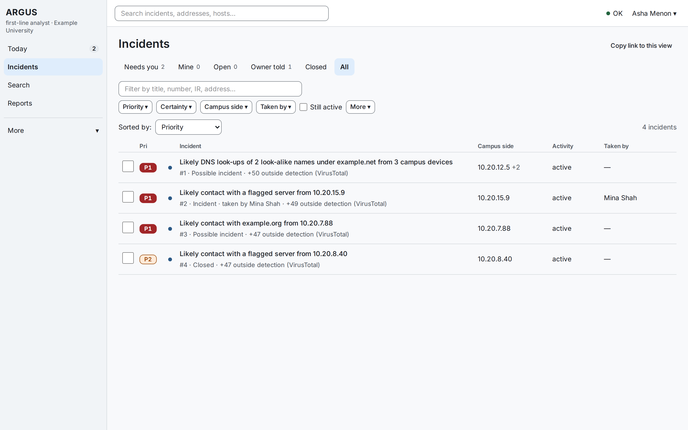

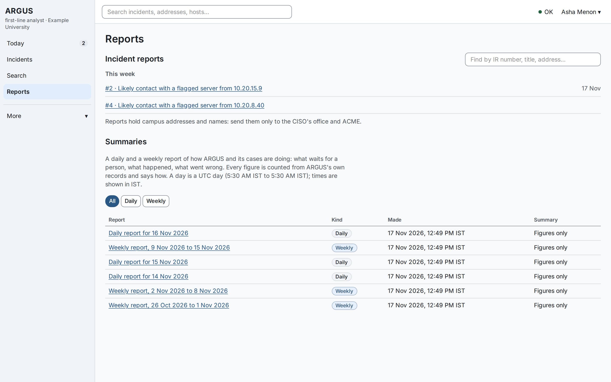

**Today** lists what needs a person: **Needs you** (possible incidents, by priority, each card
with **Confirm incident…** and **Not an incident ▾**), **Just decided** (with **Undo** for a
closure), **New activity**, **Waiting for your approval**, **ARGUS is unsure about these**, and
**Handled by ARGUS** with a short **Spot-check** of what ARGUS closed on its own.

**Incidents** is the queue, in tabs (**Needs you**, **Mine**, **Open**, **Owner told**,
**Closed**, **All**) with filters. On a wide screen a row opens a **preview** beside the list
(what happened, why, what was checked, the campus side and the other side) with the same two
decision buttons. Selected rows (`x`) can be closed together with one reason, merged (**Merge
into one…**) or compared (**Review together**); confirming is always one at a time.

**An incident's page** (`/app/incidents/<id>`; old case addresses lead here) has a sticky
**decision bar** (docked at the bottom on a phone) with ARGUS's call in words and the buttons of
the incident's state; a disabled one says why:

| State | Buttons |
|---|---|
| Possible incident | **Confirm incident…** (a dialog: what happens, what is **Still open**, **Take it myself**, a note, the exact request), **Not an incident ▾** (Expected activity, Scan or attempt: no sign it worked, Allowed by policy, Wrong rule, Duplicate of…; then **Close it**, with **Undo** for a few seconds), **Merge into…** |
| Open, nobody's | **Take it**, **Assign ▾**; under **More ▾**: Send to Kibana…, Report to the CISO…, Mark contained, Request closure, Merge into… |
| Yours | the next step first (Send to Kibana…, Report to the CISO… or Record that the owner was told…); the rest, Mark contained, Request closure, Release, Merge into…, under **More ▾** |
| Owner told | **Request closure**; under **More ▾**: Re-notify, Withdraw notice, Send to Kibana…, Report to the CISO… |
| Contained | **Request closure**; the rest under **More ▾** |
| Closed | **Reopen** (with the `reopen` capability) |

Confirming and the other incident actions need `manage_cases`; dismissing needs `review` as
well, and the bar shows the buttons only to people with `review`. Closing and a confirmed incident's merge are requests a second
person approves ([Approvals](#approvals)).

Under the bar, the tabs: **Overview** (what happened, why ARGUS raised it with its priority out of
100, what was seen, what ARGUS checked, other explanations, related incidents, next steps),
**Story** (who talked to what, the timeline), **Evidence** (with **Ask ARGUS to check something
else**: one approved, read-only question to the SIEM about one host or address, its cost shown
first), **Entities**, **Alert groups**, **Report** (the incident report with its PDF and CSVs,
every evidence line with its query and a Kibana Discover link, **Confirm the verdict** /
**Reject with a reason…**, and the **Kibana case preview**), **Activity** (the log, filtered by
People, ARGUS, AI or Kibana; **Add a note to this incident**; owner and containment). **More
about this incident** has Copy link, Copy ID, Copy IR number, Download the report (PDF),
**Everything on one page** and the raw record.

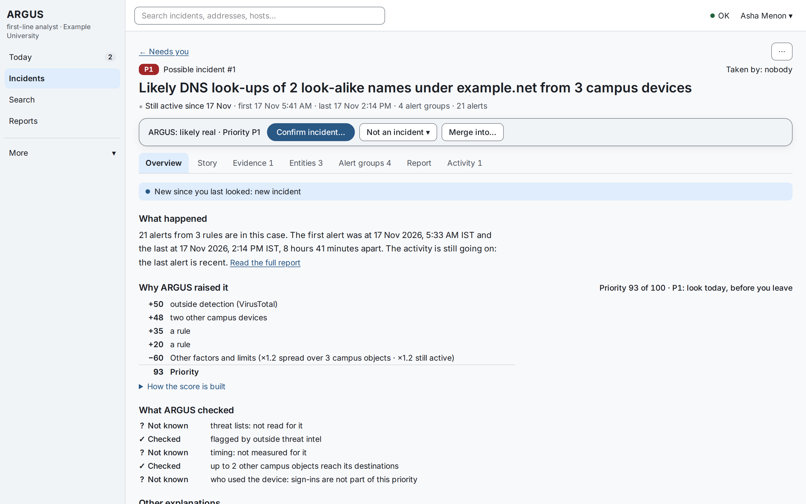

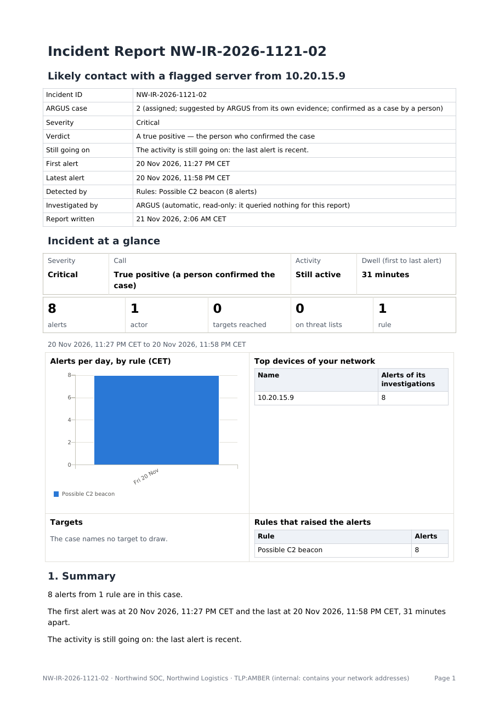

**Search** takes an address, a host, an account, a domain, a rule, an incident number or an IR
number, and lists the matching incidents and alert groups. An **entity page**
(`/app/entities/<device|account|site|outside>/<value>`) shows what ARGUS knows about it, the
incidents whose title names it and its alert groups of the last 5 days; an entity chip on an
incident opens a side panel with **Open full page**. **▸ Advanced: alert-group filters** opens the
older alert-group lists (Needs attention, by rule, by host or IP; `/app/inbox` leads there).

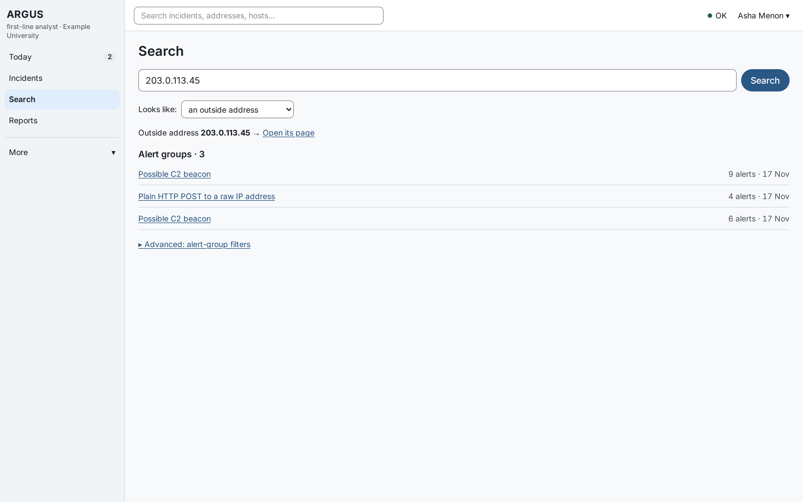

**An alert group's page** (`/app/alert-groups/<id>`) is the building block under incidents: one
rule, one actor, one day. It has a strip of key facts and tabs: **Overview**, **Report** (every
fact with the request it came from), **AI assessment** (what the decision engine and the AI
investigator propose, with the facts they quote; **Ask the AI investigator now**), **What ARGUS
checked** (the rule's own steps), **Alerts** (chosen columns; the raw alert on demand),
**History**. **Your decision** has five outcomes: **Real: open an incident…** (marking it real
opens a possible incident, or adds it to the incident that holds its activity), Real but harmless,
Allowed by policy, Wrong alert, Can't tell yet; *Come back to it* keeps it in Needs attention
for a follow-up; then **Save decision** (or **Add note only**). **Accept ARGUS's call** does it in
one click when ARGUS makes a call. **More → More queues** keeps two alert-group queues:
**Proposals** (ARGUS's proposed outcomes by group, with an audit sample and **Confirm all**) and
**Patterns** (alike alert groups to decide at once).

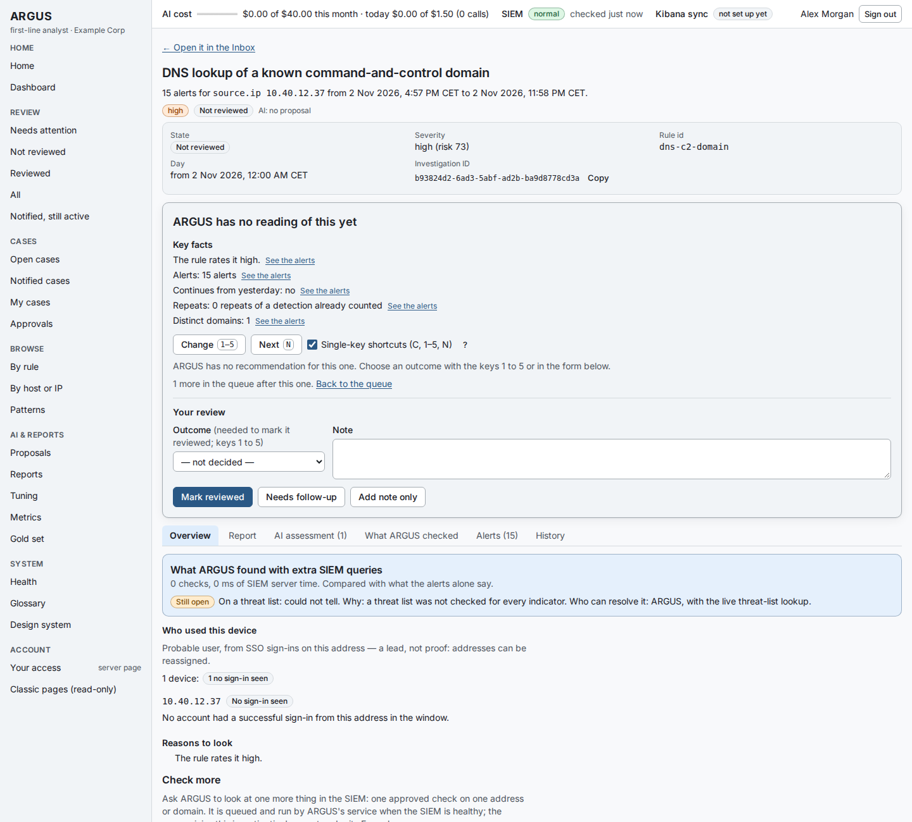

The header carries one quiet status (**● OK**, **Caution** or **Problem**) that opens to the
SIEM, ARGUS's reading, the Kibana read-back and (for an administrator) the AI cost, with a link
to System health. A banner on Today appears only in the Problem state: ARGUS has stopped reading
the SIEM, or has not measured its health for over an hour, so new incidents may be missing or
late.

**Keyboard** (while you are not typing): `j`/`k` next and previous card or row, `Enter` or `o`
open the incident, `Esc` close a pane, menu or dialog, `c` **Confirm incident…**, `d` **Not an
incident…** (then `e`, `s`, `p`, `w` or `u` for the reason), `x` select a row, `/` search, `?`
the keys; on an alert group's page `1`–`5` choose the outcome, `C` accepts ARGUS's call and `N`
goes to the next one. Nothing is sent on one key. The single-letter keys can be switched off with
the **Single-key shortcuts** box.

## How changes are made

- **What ARGUS composes for you** (confirming or dismissing an incident, accepting a proposal,
  asking the AI, deciding a group, confirming proposals, an incident action, an approval) keeps
  **the exact request it will send** one click away (**Show the exact request**). Read it, then
  confirm.
- **What you write yourself** (a decision on an alert group, a note, a gold-set answer) is saved
  from its form.
- If someone else changed the item meanwhile, nothing is saved and you see what changed.
- A failed change says why in plain words and is never retried by itself.
- Notes are for people only; they are never sent to a model or to Kibana.
- Text that came from logs, alerts, Kibana or a model is always shown as text: ARGUS takes no
  instruction from it.

## Approvals

Closing or merging a case is a request by one person and an **approval by another**, who sees the
exact changes and confirms their password. A closure for a real incident (*fixed but not
verified*, *risk accepted*) needs **two different approvers**. Groups of alike closures are
approved by a sample first, then the rest, at most 20 at a time. **Reopen** needs a reason but no
approval.

The web signs each approval with a key. Until it has one, the Approvals queue can be read but no
decision is recorded (doctor: `web.approval_key_file is not set: the approvals queue can be read,
but no decision is recorded`). The key is made **on the server** (Settings shows its path
read-only):

```bash
mkdir -p -m 700 data/keys
uv run argus approvals keygen data/keys/approval-signing.key
# wrote approval key <id> to data/keys/approval-signing.key  (mode 0600; refused if it exists)
```

```yaml
# config/local.yaml
web:
  approval_key_file: data/keys/approval-signing.key
```

```bash
systemctl --user restart argus-web
uv run argus doctor | grep 'approval signing key'
```

Back the key up with the database: approvals recorded with it are verified with it. If a Kibana
writer is ever switched on, it is given the same file to verify approvals
(`kibana.writer.approval_keys`).

Related commands: `argus approvals propose` (ARGUS's closure proposals, each for a person to
approve), `argus approvals ledger` (what people did with ARGUS's proposals, class by class).

## Sign in with ELK accounts

Optional. People sign in with their own Elasticsearch/Kibana user name and password; ARGUS checks
the credential against Elasticsearch on a lane of its own and derives each capability from what
the account **actually holds** (actions, never role names), re-checked while the session lasts:

| Capability | Checked with the person's credential |
|---|---|
| view | Kibana `login:` and the Security app's `show`; `read` on the alerts |
| see_logs | `read` on the log indices |
| review | `index` and `maintenance` on the alerts (the alert-status privileges) |
| manage_cases | Kibana Cases: create, update, comment |
| reopen | Kibana Cases: reopen |
| approve | the application privilege action `argus:approve` (application `argus`) |
| admin | the application privilege action `argus:admin` (application `argus`) |

Superusers are always refused, and so are accounts holding cluster administration privileges
(`manage`, `manage_security`, `manage_api_key`, ...) unless `identity.admin_accounts` says
otherwise. `answer_gold` is given in ARGUS, not by ELK. `uv run argus identity map` prints the
map for your Kibana's feature ids; `uv run argus identity check` checks one account (the password
is asked, never passed).

To switch it on, first give the web its own secret **on the server** (once):

```bash
mkdir -p -m 700 data/keys
uv run argus sessions keygen data/keys/web-secret      # 64 hex digits, mode 0600
```

```yaml
# config/local.yaml
web:
  secret_file: data/keys/web-secret
  database_role: api        # the installer already set this
```

Then, in the app, turn on `web.elk_signin` in **Settings → The web app** (it asks for your
password again); the timeouts and the accounts refused or allowed as administrators are in
**Settings → Sign-in through ELK**. ELK sign-in needs TLS unless the web is on the loopback (a
password is typed only over TLS). Then move people over one by one, keeping their history (on the
server):

```bash
uv run argus identity link alice --elk alice.example    # the local account finds the ELK one
uv run argus identity cutover                           # where each account stands
uv run argus identity disable-local alice               # after her first ELK sign-in worked
```

The way back is to turn `web.elk_signin` off again in Settings (local passwords are kept until
each person's ELK sign-in has worked; `argus identity enable-local` gives one back). In Users and
roles, people who sign in through ELK carry an *ELK sign-in* badge and their access is changed in
ELK.

## The emergency account

With ELK sign-in on, a break-glass account lets people **view and review** while ELK cannot be
asked. It is deliberately **not** in the app (it is for when sign-in itself is broken): a person
at the ARGUS machine switches it on (it asks why and checks that the SIEM is really down), and
gets a one-time password:

```bash
uv run argus break-glass on
uv run argus break-glass status
uv run argus break-glass off
```

Nothing it does reaches Kibana; it cannot approve or change settings. Users and roles shows it
as the *Emergency account*, read-only.

## The API

The app talks to a versioned JSON API under `/api/v1`, described by
[`docs/api/openapi-v1.json`](api/openapi-v1.json). It uses the same sessions and capabilities as
the pages (a signed-in browser session with its CSRF token).

## Troubleshooting the web

| Symptom | Cause and fix |
|---|---|
| `argus-web` exits at start: `the web app listens on the loopback only unless it has TLS (tls_cert, tls_key), allowed_hosts and allowed_networks` | `units.web.host` (or `web.host`) is not the loopback but one of the other three is missing. Rerun `./install.sh` and give the address. |
| The browser says *Invalid host header* or the connection is refused from another machine | The name in the address bar is not in the allowed hosts, or the client is not in the allowed networks (Settings → The web app), or the firewall blocks 8765. If you cannot reach the app at all, fix it on the server: rerun `./install.sh` with the right address. |
| Settings or the setup says *argus-admin is not running* | Changes wait until it runs. On the server: `systemctl --user status argus-admin`, `journalctl --user -u argus-admin -n 50`, then `systemctl --user restart argus-admin`. `uv run argus admin status` shows when it was last seen. |
| A change shows **rolled back** | A service did not start with the new value, so the previous files were put back. The outcome line says which service; `journalctl --user -u <that service> -n 30` says why. |
| A change shows **refused** | `argus-admin` did not accept the value (the reason is shown), or the installation uses the hardened custody layout, where settings are changed by the custodian on the server. |
| *Confirm your password again (within five minutes)* | Use *Confirm your password* (a new tab), then save again: your edits are kept. |
| The one-time link has expired | For a person: *New password link* in Users and roles. For the first administrator: rerun `./install.sh`. |
| Approvals cannot be decided | No approval key: see [Approvals](#approvals). |
| Doctor: `web certificate pin` FAIL | The served certificate changed: update `web.tls_pin_sha256`. |
| Doctor: `frontend build` FAIL | The committed web build does not match `frontend/` (a local change to the frontend): rebuild it ([development.md](development.md#the-web-app)) or `git checkout frontend src/argus/web/spa`. |

More: [troubleshooting.md](troubleshooting.md).
