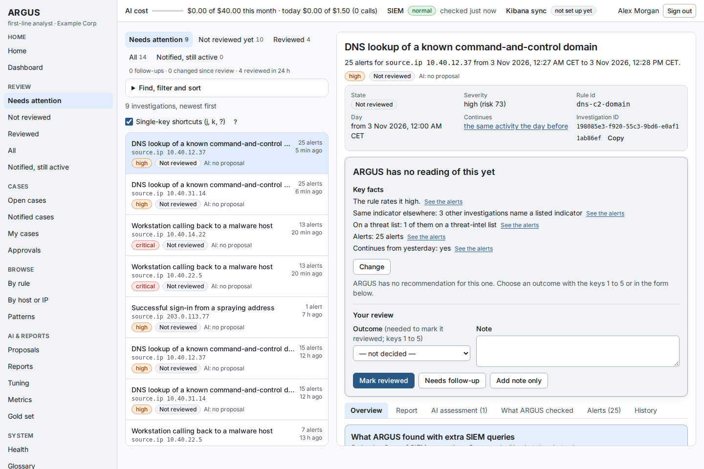
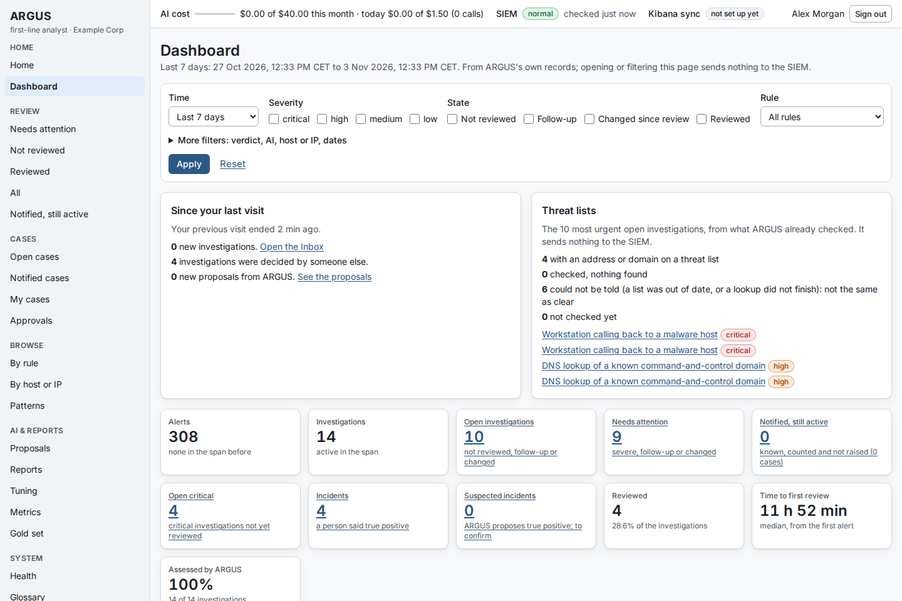
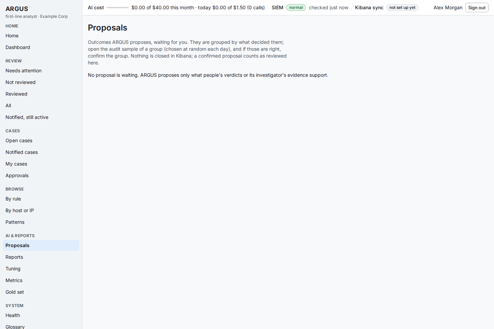
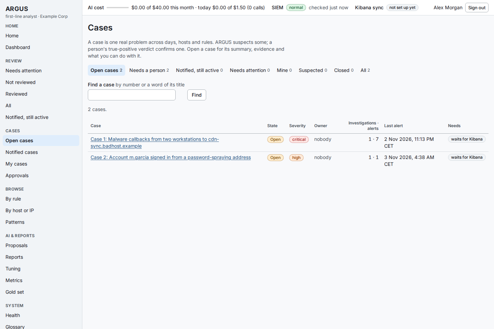
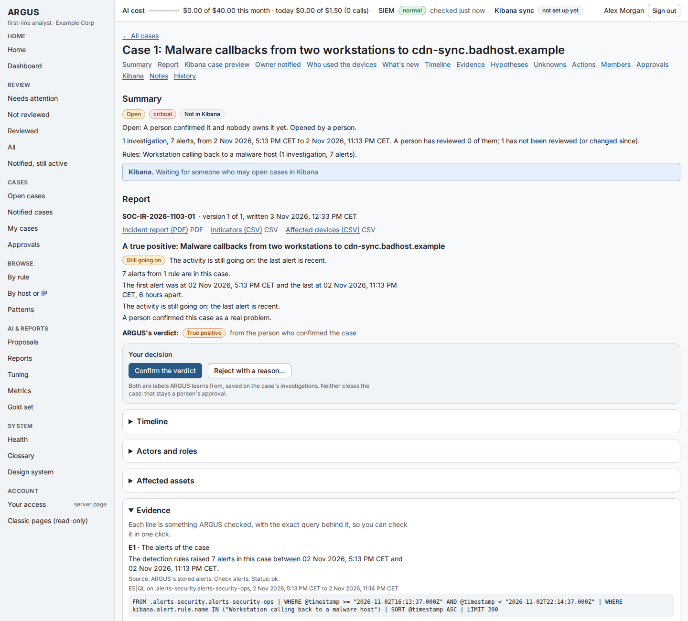
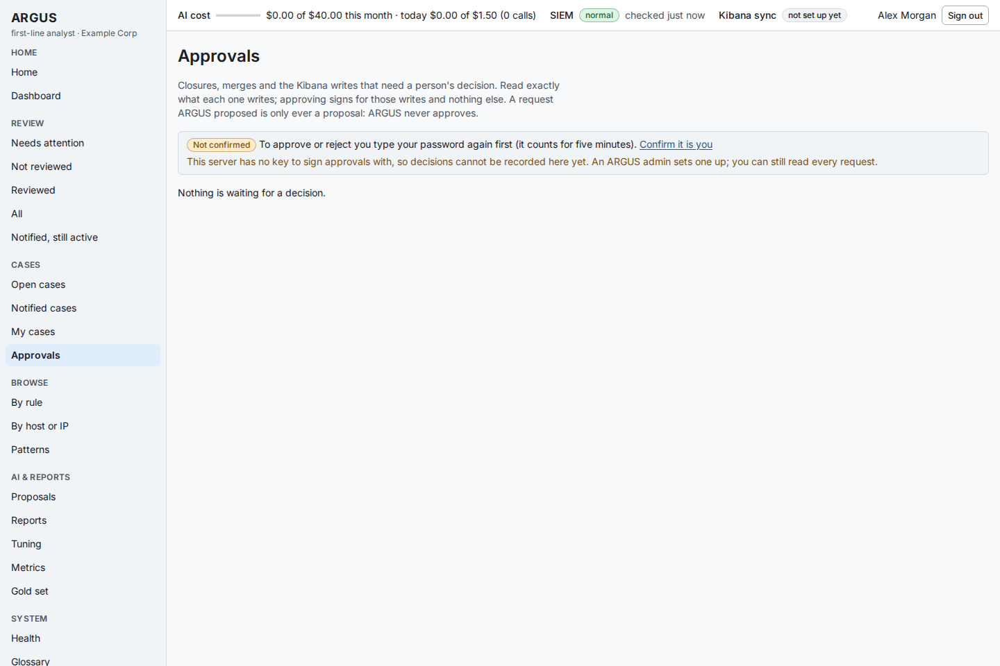

# Web UI Guide

The ARGUS **Inbox** is where people meet ARGUS's work: what needs attention, the investigations
with their evidence, ARGUS's proposals, cases, approvals and reports. This page is for whoever
sets it up and administers it. The guide for the people who review alerts every day is
[guide-ta-ra.md](guide-ta-ra.md) (written for reviewers: research and teaching assistants in the
original deployment, analysts anywhere).

**Contents**

- [Opening it](#opening-it)
- [Signing in](#signing-in)
- [Users and capabilities](#users-and-capabilities)
- [The pages](#the-pages)
- [How changes are made](#how-changes-are-made)
- [Approvals](#approvals)
- [Sign in with ELK accounts](#sign-in-with-elk-accounts)
- [The emergency account](#the-emergency-account)
- [The API](#the-api)
- [Troubleshooting the web](#troubleshooting-the-web)

---

## Opening it

`argus-web` serves the Inbox on **`127.0.0.1:8765`** by default. Two ways to reach it:

- **An SSH forward** (nothing to configure):

  ```bash
  ssh -L 8765:127.0.0.1:8765 argus@argus-host.example.org
  # then open http://127.0.0.1:8765/
  ```

- **On the network, over HTTPS**: a certificate, the host names browsers use, and the client
  networks allowed, all three required. See
  [install.md](install.md#73-your-own-certificate-and-the-firewall).

The app lives at `/app`; the address `/` and the older page addresses lead there. Light and dark
follow the browser's system setting. It is tested in current Chromium (Chrome, Edge) and Firefox.




## Signing in

The sign-in page is `/signin`. By default people sign in with **local accounts** made on the
ARGUS machine ([next section](#users-and-capabilities)); optionally with their own ELK accounts
([below](#sign-in-with-elk-accounts)).


- **Failed sign-ins** slow down: after a second refusal the next check of that name from that
  client waits 1 s, then 2, then 4; the fifth refusal within 15 minutes locks the name for a
  while. Every failure gets the same answer after the same delay, so a wrong name cannot be told
  from a wrong password.
- **Sessions** end after 30 minutes without a request of the person's (the status bar's own
  refreshes do not count) and 8 hours after sign-in in any case (`web.session_idle`,
  `web.session_absolute`).
- **Step-up:** approving asks for the password again.
- **Never past a certificate warning.** Tell reviewers to stop and report any certificate warning
  instead of clicking through.

## Users and capabilities

```bash
uv run argus user add alice --name "Alice Example"     # the password is asked twice
uv run argus user add bob --capability view --capability review
uv run argus user list                                  # accounts, capabilities, last seen
uv run argus user grant alice manage_cases reopen approve
uv run argus user revoke alice approve
uv run argus user disable bob                           # their sessions end at once
uv run argus sessions end-all                           # end every session
```

User names are lowercase, 2–32 characters. A new account without `--capability` gets **view,
see_logs, review, answer_gold**.

| Capability | Lets a person | Needs |
|---|---|---|
| `view` | use ARGUS: see investigations, alerts and reports | |
| `see_logs` | see raw logs and the facts ARGUS read from them (and sign-in usernames) | view |
| `review` | review: verdicts, group reviews, accepting proposals, asking the AI | view |
| `answer_gold` | answer gold-set items | view, review |
| `manage_cases` | manage cases: take, assign, contain, request closure, merge, open | view |
| `reopen` | reopen a closed case | view |
| `approve` | approve closures and other requests, after confirming it is them | view, manage_cases |
| `admin` | change ARGUS's settings | view |

A capability counts only with its prerequisites; a grant whose prerequisite is missing grants
nothing. Changes reach a person's open sessions at their next request (`grant`) or at once
(`revoke`, `disable`). The **Your access** page (in the Account menu) tells each person what they
may do and why; send people there when a button is greyed out.

## The pages

The menu is on the left (behind *Menu* on a phone):

| Section | Page | What it is |
|---|---|---|
| **Home** | Home | What needs a person today, in order: ARGUS's cases, the patterns to close, single investigations |
| | Dashboard | Alerts, investigations and incidents (confirmed cases) at a glance |
| **Review** | Needs attention | Follow-ups, changed and severe investigations: **start here** |
| | Not reviewed / Reviewed / All | Every investigation, by review state |
| | Notified, still active | Devices whose owner was told: counted, not raised |
| **Cases** | Needs a decision / Open incidents / Notified cases / My cases | Possible incidents to confirm or dismiss, and confirmed incidents across investigations |
| | Approvals | Closures and merges waiting for a second person |
| **Browse** | By rule / By host or IP | Investigations per detection rule, or per host, address, domain or user |
| | Patterns | Groups of alike investigations, to decide at once |
| **AI & reports** | Proposals | Outcomes ARGUS proposes, grouped by what decided them, with an audit sample |
| | Reports | The daily and weekly reports (figures say how they were counted) |
| | Tuning | Weekly per-rule suggestions to make noisy rules quieter (you apply them in Kibana) |
| | Metrics | How the AI is doing: results, waiting work, cost against the caps |
| | Gold set | The answer key that measures how often ARGUS is right |
| **System** | Health | Whether data is arriving, and any gaps (a gap is *unknown*, never *clean*) |
| | Glossary | Every page and word explained |
| | Design system | The app's colours and components (for developers) |
| **Account** | Your access | What you may do and why (a server page) |








**An investigation's page** has a strip of key facts and tabs: **Overview** (the verdict in a
few lines, the reasons to look, what ARGUS found), **Report** (every fact with the request it
came from), **AI assessment** (what the decision engine and the AI investigator propose, with the
facts they quote), **What ARGUS checked** (the rule's own steps), **Alerts** (the alerts with
chosen columns; the raw alert on demand), **History**. The decision is made in **Your review**:
a decision (Real: act on it; Real but harmless; Allowed by policy; Wrong alert; Can't tell yet,
over the review outcomes true positive, benign: expected activity, benign: allowed by policy,
rule false positive and inconclusive), *Come back to it* for a follow-up, a note, *Save
decision*; *Accept ARGUS's call* does it in one click when ARGUS makes a call.


**A case's page** reads: for a possible incident (a suspected case) the decision first (**Confirm
as incident**, **Not an incident…** with a reason, **Merge into…**; `POST
/api/v1/cases/{id}/confirm` and `/dismiss`, the same commands as `argus case confirm` and
`dismiss`, needing `manage_cases`, and `review` too for a dismissal), then the summary with the
case's one IR number, the incident **Report** (with a PDF and CSVs of indicators and affected
devices; every evidence line has its query and a link that opens it in Kibana; its header says
the case's state and ARGUS's call apart), what's new, timeline, evidence, hypotheses, unknowns,
actions, members, the Kibana mirror, notes, history. Actions: Take, Assign, Release, Contain,
Request closure, Merge, Reopen, **Check more** (one approved, read-only question to the SIEM about
one host or address, its cost shown first).

The header carries one quiet **System: OK** that opens to the SIEM, the Kibana read-back and (for
an admin) the AI cost; a banner appears only when the queue itself may be incomplete (ARGUS is
not reading the SIEM, or has read no new alert for two hours).




**Keyboard** on the lists: `j`/`k` or the arrows move, `Enter` opens, `Esc` goes back, `?` lists
the keys.

## How changes are made

- **What ARGUS composes for you** (accepting a proposal, asking the AI, deciding a group,
  confirming proposals, a case action, an approval) first shows **the exact request it will
  send**. Read it, then confirm.
- **What you write yourself** (a review, a note, a gold-set answer) is saved from its form.
- If someone else changed the item meanwhile, nothing is saved and you see what changed.
- A failed change says why in plain words and is never retried by itself.
- Notes are for people only; they are never sent to a model.
- Text that came from logs, alerts, Kibana or a model is always shown as text: ARGUS takes no
  instruction from it.

## Approvals

Closing or merging a case is a request by one person and an **approval by another**, who sees the
exact changes and confirms their password. A closure for a real incident (*fixed but not
verified*, *risk accepted*) needs **two different approvers**. Groups of alike closures are
approved by a sample first, then the rest, at most 20 at a time. **Reopen** needs a reason but no
approval.



The web signs each approval with a key. Until it has one, the Approvals queue can be read but no
decision is recorded (doctor: `web.approval_key_file is not set: the approvals queue can be read,
but no decision is recorded`). Make one and give it to the web:

```bash
mkdir -p -m 700 data/keys
uv run argus approvals keygen data/keys/approval-signing.key
# wrote approval key <id> to data/keys/approval-signing.key  (mode 0600; refused if it exists)
```

```yaml
# config/local.yaml
web:
  approval_key_file: data/keys/approval-signing.key
```

```bash
systemctl --user restart argus-web
uv run argus doctor | grep 'approval signing key'
```

Back the key up with the database: approvals recorded with it are verified with it. If a Kibana
writer is ever switched on, it is given the same file to verify approvals
(`kibana.writer.approval_keys`).

Related commands: `argus approvals propose` (ARGUS's closure proposals, each for a person to
approve), `argus approvals ledger` (what people did with ARGUS's proposals, class by class).

## Sign in with ELK accounts

Optional. People sign in with their own Elasticsearch/Kibana user name and password; ARGUS checks
the credential against Elasticsearch on a lane of its own and derives each capability from what
the account **actually holds** (actions, never role names), re-checked while the session lasts:

| Capability | Checked with the person's credential |
|---|---|
| view | Kibana `login:` and the Security app's `show`; `read` on the alerts |
| see_logs | `read` on the log indices |
| review | `index` and `maintenance` on the alerts (the alert-status privileges) |
| manage_cases | Kibana Cases: create, update, comment |
| reopen | Kibana Cases: reopen |
| approve | the application privilege action `argus:approve` (application `argus`) |
| admin | the application privilege action `argus:admin` (application `argus`) |

Superusers are always refused, and so are accounts holding cluster administration privileges
(`manage`, `manage_security`, `manage_api_key`, ...) unless `identity.admin_accounts` says
otherwise. `answer_gold` is given in ARGUS, not by ELK. `uv run argus identity map` prints the
map for your Kibana's feature ids; `uv run argus identity check` checks one account (the password
is asked, never passed).

To switch it on:

```bash
mkdir -p -m 700 data/keys
uv run argus sessions keygen data/keys/web-secret      # 64 hex digits, mode 0600
```

```yaml
# config/local.yaml
web:
  elk_signin: true
  secret_file: data/keys/web-secret
  database_role: api        # argus init already set this
```

ELK sign-in needs TLS unless the web is on the loopback (a password is typed only over TLS).
Restart the web. Then move people over one by one, keeping their history:

```bash
uv run argus identity link alice --elk alice.example    # the local account finds the ELK one
uv run argus identity cutover                           # where each account stands
uv run argus identity disable-local alice               # after her first ELK sign-in worked
```

The way back is to set `elk_signin: false` (local passwords are kept until each person's ELK
sign-in has worked; `argus identity enable-local` gives one back).

## The emergency account

With ELK sign-in on, a break-glass account lets people **view and review** while ELK cannot be
asked. A person at the ARGUS machine switches it on (it asks why and checks that the SIEM is
really down), and gets a one-time password:

```bash
uv run argus break-glass on
uv run argus break-glass status
uv run argus break-glass off
```

Nothing it does reaches Kibana; it cannot approve or change settings.

## The API

The app talks to a versioned JSON API under `/api/v1`, described by
[`docs/api/openapi-v1.json`](api/openapi-v1.json). It uses the same sessions and capabilities as
the pages (a signed-in browser session with its CSRF token).

## Troubleshooting the web

| Symptom | Cause and fix |
|---|---|
| `argus-web` exits at start: `the web app listens on the loopback only unless it has TLS (tls_cert, tls_key), allowed_hosts and allowed_networks` | `units.web.host` (or `web.host`) is not the loopback but one of the other three is missing. |
| The browser says *Invalid host header* or the connection is refused from another machine | The name in the address bar is not in `allowed_hosts`, or the client is not in `allowed_networks`, or the firewall blocks 8765. |
| Approvals cannot be decided | No approval key: see [Approvals](#approvals). |
| Doctor: `web certificate pin` FAIL | The served certificate changed: update `web.tls_pin_sha256`. |
| Doctor: `frontend build` FAIL | The committed web build does not match `frontend/` (a local change to the frontend): rebuild it ([development.md](development.md#the-web-app)) or `git checkout frontend src/argus/web/spa`. |

More: [troubleshooting.md](troubleshooting.md).
